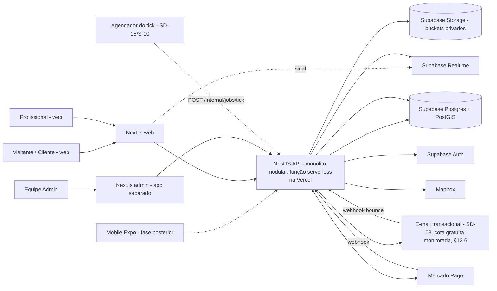

# FastPro — Arquitetura (nível lógico)

- **Etapa:** architecture · **Data:** 2026-11-09 · **Papel:** Software Architect · **Status:** rascunho para validação humana (revisão 2)
- **Natureza:** SOMENTE planejamento. Nenhum código, repositório, conta, projeto, credencial ou chamada externa foi criado/feito. Nenhum limite de serviço externo foi consultado em fonte oficial nesta sessão (a web não foi consultada; todo limite/termo de Vercel, Supabase, Mapbox, Mercado Pago e e-mail permanece `[NÃO VERIFICADO]`).

## Histórico de mudanças
### Revisão 6 — 2026-11-10 (Rodada 14 nº 31 e 32; Revisão 5 do PO)
- **Fotos do pedido (decisão 31):** reduzidas **no envio** para ≈ **0,5 MB** e **no máximo 1.280 px**, **5 por pedido** (≈ 2,5 MB/pedido; ≈ 280 pedidos em ≈ 700 MB de Storage). **Só a versão reduzida é guardada**: o original e qualquer *master* maior nunca são persistidos. Supera o alvo "1–2 MB" da revisão 5.
- **Chat somente texto (decisões 32 e 33):** nenhum anexo, nem imagem nem PDF. **Removidos:** bucket `chat-attachments`, tabela `message_attachment`, validação por conteúdo e antimalware de anexos do chat, URLs assinadas e limites (5 × 10 MB) de anexo, miniatura e marca d'água do chat, e os riscos/testes de PDF do chat. A API **rejeita qualquer anexo** no chat. EXIF só se aplica às fotos do pedido.
- **Fotos extras** só via WhatsApp com opt-in (inalterado). **AMB-32 (PDF no chat) fica superada** pela decisão 33. **SD-12** (antivírus) é reduzida: sem anexos no chat, resta apenas o risco menor dos documentos de verificação (acesso só da Verificação).
- **Storage passa a ter apenas fotos do pedido e documentos de verificação de identidade**; estimativas refeitas (09 §9). O **egress de fotos (5 GB/mês)** segue como limite mais apertado.

### Revisão 5 — 2026-11-10 (Rodada 13 nº 28, 29, 30; leitura de documentação 2 em `13-VERIFICACAO-SERVICOS.md`)
- **Vercel (decisão 28):** o plano Hobby é só uso pessoal **não comercial** (processar pagamento conta como comercial). Desenvolver/testar no Hobby e **migrar para o Pro ao começar a cobrar** (≈ US$ 20/mês + US$ 20 por seat). NestJS é suportado como uma única Vercel Function (Fluid compute, bundle até 250 MB). **Cron do Hobby = 1 vez por dia (±59 min)**: o desenho **não depende de cron da Vercel**.
- **Tick de jobs:** `pg_cron`/`pg_net` do Supabase como primeira opção, mas **PostGIS/pg_cron/pg_net no plano Free = NÃO ENCONTRADO** na documentação ⇒ spike S-02/S-10 com plano B (chamada HTTP externa gratuita) e plano C (tick oportunista nas próprias requisições) (§16.2).
- **Mapbox (decisão 29):** autocomplete e mapas no gratuito (resultado **temporário, nunca armazenado**); coordenadas só persistem via geocodificação **permanente** (US$ 5/1.000, cartão, limite de gasto). Fluxo ajustado (§9.5): o cliente escolhe a sugestão e **uma única chamada `permanent=true` no servidor** grava a coordenada; custo estimado por pedido. SD-02 respondida.
- **Fotos (decisão 30):** máximo **5 por pedido**; adicionais só via WhatsApp se o cliente aceitar compartilhar o contato; senão ficam as 5. Compressão no envio (alvo 1–2 MB) é **PROPOSTA** (§10.4).
- **Supabase Free (verificado):** pausa após 1 semana, 2 projetos ativos, banco 500 MB, Storage 1 GB, egress 5 GB, Realtime 200 conexões/2 mi mensagens, 60 conexões diretas/200 no pooler, sem backup. Estimativas de espaço refeitas (09 §9).
- **Mercado Pago:** tarifas **não obtidas** (403); Pix Automático **não encontrado** (Pix manual, coerente com o desenho); o teste grátis sem cartão é do **nosso app**, não do MP. Webhooks `x-signature` e reenvio a cada 15 min (resumo, a reconfirmar).
- **SD:** SD-01, SD-02 e SD-15 respondidas/reencaminhadas (ver `10-ADRS.md`).

### Revisão 4 — 2026-11-09 (Rodada 12 nº 27; fatos do Resend de `13-VERIFICACAO-SERVICOS.md`)
- **Todos os e-mails ficam HABILITADOS no código** (aceite, mensagem não lida, lembretes, seleção, cancelamento, desistência, trial/ciclo e login). **Supera** o "desativado no código" da Rodada 9 nº 23: **removidos** o ponto de ativação `ATIVAR-AVISOS-EMAIL` e o conceito de "e-mail desativado". Mantidos: sem interruptor/tela administrável, sem tabela de flags e **sem reenvio de aceites antigos**.
- **Resend (fatos verificados, doc 13):** plano gratuito = **100 e-mails/dia (UTC), 3.000/mês**, cada destinatário conta, e-mails de teste (`resend.dev`) também consomem cota, 10 requisições/s; **domínio verificado é exigido para enviar**. Em desenvolvimento o destino é o **Mailpit local**; envio real só com domínio verificado (decisão 15).
- **Cota como parte do desenho (§12.6):** contador de uso `external_quota` (dia UTC e mês), alertas e degradação (login tem prioridade; chat/site continuam); agrupamento de 15 min preserva a cota. Valores de alerta/reserva são `[PROPOSTA]`.
- A premissa da revisão 3 de que o "modo de teste" do Resend enviaria ao e-mail do titular sem domínio **não está confirmada** (doc 13): não é mais premissa.

### Revisão 3 — 2026-11-09 (Rodadas 8 e 9; trecho de e-mail desativado SUPERADO pela revisão 4)
- **Rodada 9 nº 23: sem interruptor.** Removidos `notification_flag`, tela/endpoint administrável, auditoria de flag e o "estado por tipo". O envio dos e-mails de **aviso de aceite** e de **mensagem não lida** fica **implementado, porém desativado no código**, com **um único ponto de ativação documentado** (§12.2). Não há reenvio de aceites antigos. O link mágico e os e-mails de conta seguem ativos.
- **Rodada 9 nº 22:** o aviso "o FastPro apenas conecta, não é contrato" fica **só nos termos de uso**, não no botão/UI do aceite.
- **Rodada 8:** nº 17 (SD-16) período novo começa no fim do anterior; nº 19 (Rodada 8 nº 19) sem novo aceite após retirada; nº 20 (AMB-27) "4 aceites" = vagas consumidas; nº 14 mensagem automática do aceite com o texto fixo "Estou disponível para trabalhar"; nº 18 backup manual vai para `12-TODO.md` (`12-TODO.md` adiada).
- SD-03 (domínio) e SD-15 (termos Vercel/NestJS serverless) **adiadas** (tratadas em `12-TODO.md` e antes da primeira cobrança/lançamento real); SD-16, Rodada 8 nº 19, SD-19, SD-20 respondidas.
### Revisão 2 — 2026-11-09 (Rodadas 5 e 6: H1, H3, H4, H5 e respostas 1–7)
- **H4: fim da oferta.** Removidos `offer`, `offer_revision`, o lock "enviar/editar oferta" e o gatilho "4 ofertas". Entra o **aceite de trabalho** (`acceptance`), regra única por `(pedido, profissional)`, idempotente (§7.2). Respostas 1–3: o aceite ocupa a vaga, cria a conversa e libera o primeiro nome, tudo na mesma transação; a conversa recebe uma **mensagem de sistema** idempotente (§7.2, §11); o profissional pode **retirar** o aceite antes da seleção e a vaga **permanece consumida** (§7.3).
- **2ª onda** passa a depender do contador de aceites (vagas consumidas), uma única vez, rótulo da UI "Chamar mais profissionais" (§7.3).
- **Resposta 5 / RF-122 (SUPERADA pela Rodada 9 nº 23):** havia interruptor por tipo de e-mail; foi **removido**. Vale: aviso de aceite e de mensagem não lida **desativados no código**, sem tabela de flags, tela ou auditoria (§12.2); link mágico sempre ativo.
- **H5:** sem boleto; Pix e cartão. **Carência de 72 h vale para Pix** (e cartão), por função de tempo (§8). SD-10 respondida.
- **H1:** hospedagem na **Vercel** (Next.js e API). NestJS roda como função serverless: impactos em jobs, rate limit, mídia e termos do plano gratuito, todos `[NÃO VERIFICADO]`, com alternativas (§16, ADR-018, SD-15). **H3:** Supabase gratuito mantido com **backup manual periódico** (§16.7, `12-TODO.md`).
- **Resposta 4:** preço e contratação são **diretos entre as partes**; o FastPro apenas conecta (§0, regra 5). Sem escrow, sem valor/prazo estruturado, sem intermediação de pagamento do serviço.
- Renomeações: `participation` → `acceptance`; `offers_deadline_at` → `acceptance_deadline_at`; `offers_received` → `acceptances_count`; categoria de notificação `oferta` → `aceite`.
- **Rodada 7:** provedor de e-mail **Resend** atrás de `EmailProviderPort`, também candidato a SMTP customizado do Supabase Auth; exigência provável de **domínio verificado** tratada como risco R-33/SD-03 com plano de desenvolvimento sem domínio (Mailpit local) (§12.5). O cliente só vê os aceites abrindo o site; e-mails preparados e desligados (§12.2).
- **Solicitações de decisão:** SD-01, SD-07, SD-08, SD-10 respondidas/extintas; SD-03 reescrita (Resend; domínio); SD-15..SD-20 criadas na revisão 2 e tratadas na revisão 3 (ver acima e `10-ADRS.md`).
- **Etiquetas:** `[APROVADO]` decisão do usuário · `[DELEGADO]` adotado por delegação (ver `11-DECISOES.md`) · `[PROPOSTA]` proposta do Architect, a validar · `[NÃO VERIFICADO]` fato externo sem fonte consultada (valores vêm de memória e podem estar desatualizados) · `[PENDENTE JURÍDICO]`
- **Documentos relacionados:** `09-MODELO-DADOS.md` (dados), `10-ADRS.md` (decisões, alternativas, riscos, tabela de limites gratuitos e solicitações de decisão SD-xx), `11-ARQ-RISCOS-E-TESTES.md` (invariantes, contratos, riscos, testes).
- **Entradas:** `01`–`05`, `07`, `10`, `11` de `docs/factory/` e pacote `05`, `06`, `07`. RN-001..408/641..675 e PRD/EDS originais continuam NÃO recebidos; as referências são aos RF/FA/AMB da fábrica.

## 0. Regras deste documento
1. A stack aprovada **não é substituída**: Next.js, React Native + Expo, NestJS, Supabase (Postgres/Auth/Storage/Realtime), Mapbox, Mercado Pago, pnpm + Turborepo, Admin web separado. [APROVADO]
2. Qualquer necessidade que altere a stack, adicione componente fora dela ou mude requisito aparece como **solicitação de decisão (SD-xx)** em `10-ADRS.md` §SD. Nada aqui as presume aprovadas.
3. **Restrição de orçamento [APROVADO]:** não há orçamento; só recursos gratuitos no desenvolvimento e início. Nada pago é premissa; planos pagos aparecem somente como **gatilho de upgrade/migração** (§16 e ADR-020).
4. Parâmetros numéricos técnicos (timeouts, limites, janelas) são `[PROPOSTA]` e ficam em configuração administrável, não em código. Prazos legais não são inventados.
5. **Limite de responsabilidade do produto [APROVADO, resposta 4]:** o FastPro **apenas conecta** cliente e profissional. Preço, prazo e contratação são combinados **diretamente entre as partes**, no chat ou por WhatsApp (opt-in). Consequências arquiteturais: (a) não existe entidade de proposta/oferta, orçamento, contrato, valor do serviço ou escrow; (b) nenhum campo estruturado de preço/prazo em tabela do domínio de pedidos; (c) o Mercado Pago é usado **somente** para a assinatura do profissional; (d) "selecionar" e "concluir" registram a escolha do cliente na plataforma e **não** formam contrato nem pagamento. O texto "não é contrato" não foi respondido (AMB-28); a redação depende de `[PENDENTE JURÍDICO]` L2/L7.

---

## 1. Contexto e princípios

### 1.1 Princípios arquiteturais [PROPOSTA]
| # | Princípio | Consequência |
|---|---|---|
| P1 | **Domínio no servidor** (NestJS) é a fonte de decisão; frontend só apresenta | Nenhuma regra de elegibilidade, vaga ou visibilidade depende do cliente |
| P2 | **Defesa em profundidade**: RLS, constraints e triggers como rede de segurança sob o NestJS | Um bug de serviço não deve virar vazamento ou estado inválido |
| P3 | **Invariantes no banco** onde possível (unique parciais, checks, triggers) | Concorrência não depende só de código de aplicação |
| P4 | **Tempo verificado no uso**, não por job | Expiração, trial, carência valem mesmo que um job atrase |
| P5 | **Estados ortogonais**, derivados quando possível | Sem enum único; sem estado armazenado divergente |
| P6 | **Idempotência por chave** em toda operação com efeito | Repetição/retry não duplica |
| P7 | **Efeitos externos via outbox** (e-mail, eventos, webhooks de saída) | Sem notificação para estado que sofreu rollback |
| P8 | **Mínimo de PII em qualquer lugar** (logs, eventos, métricas, e-mails) | Observabilidade sem PII |
| P9 | **Degradação graciosa** diante de cota/limite gratuito | Perder conforto (realtime, autocomplete) nunca perde integridade |
| P10 | **Negação indistinguível** (404 no lugar de 403 para recurso de terceiro) | Anti-enumeração |

### 1.2 Contexto (sistema e atores externos)

Fronteiras de confiança: navegador/app (não confiável) · API/Worker (confiável, único com credenciais privilegiadas) · Supabase (confiável, mas RLS ativa) · serviços de terceiros (dados enviados são minimizados e listados como suboperadores `[PENDENTE JURÍDICO]` L2).

### 1.3 Estilo: monólito modular [PROPOSTA] (ADR-001)
Um único deploy NestJS organizado em módulos com limites explícitos (cada módulo possui suas tabelas; outros módulos só acessam por interface pública do módulo). **Na Vercel (H1) o NestJS roda como uma única função serverless** (um aplicativo, não uma função por endpoint) `[NÃO VERIFICADO: suporte e limites]`. Não há processo residente: o "worker" é o mesmo código invocado por `POST /internal/jobs/tick` (jobs/outbox em lotes curtos, com *lease*), e toda correção independe de timers em memória (§16). Microserviços e filas externas ficam fora (custo operacional e orçamento).

### 1.4 Monorepo (pnpm + Turborepo) [PROPOSTA]
```
apps/web          Next.js (cliente e profissional) — projeto Vercel
apps/admin        Next.js (admin, build/origem/cookies separados) — outro projeto Vercel
apps/api          NestJS (aplicativo único; entrada serverless HTTP + rota interna de tick) — Vercel (SD-15)
apps/mobile       Expo (fase posterior; vazio no MVP)
packages/contracts   esquemas de DTO/eventos (fonte do OpenAPI e dos tipos)
packages/tokens      tokens do EDS (único lugar de cores; sem hex em componentes)
packages/ui          componentes compartilhados web (mobile reutiliza só tokens)
packages/db          migrações SQL, seeds sintéticos, testes de banco (pgTAP)
packages/access-matrix  matriz de acesso legível por máquina (ver §4.4)
packages/testkit     fixtures sintéticos, helpers de concorrência
```
Pipeline de CI gratuito (cota de minutos `[NÃO VERIFICADO]`): lint, tipos, testes unitários, testes de banco e de concorrência em Postgres local efêmero; cache do Turborepo.

---

## 2. Módulos

| Módulo | Responsabilidade | Dados que possui (ver 09) | RF/FA principais |
|---|---|---|---|
| `identity` | Cliente (desafio link/código), profissional (Auth), sessão, step-up, bloqueios | app_user, auth_challenge, app_session | RF-035..041, FA-002/003 |
| `catalog` | Grupos, serviços, sinônimos, flags online/regulamentada, busca | service_group, service, service_synonym | RF-002/003/004 |
| `geo` | Geocodificação, generalização, elegibilidade por raio, cobertura | geo_place, professional_area | RF-004/013/051, AMB-03 |
| `requests` | Rascunho, publicação, ciclo de vida, cadeia, republicação | request_draft, service_request, request_chain | RF-010..021, 080..094 |
| `distribution` | Aceite de trabalho (vaga 4+4), retirada do aceite, 2ª onda, descoberta | acceptance, wave state (`wave2_opened_at`, `acceptances_count`) | RF-065..076, FA-010/011 |
| `selection` | Seleção, troca, conclusão, correção, cancelamento, desistência | selection, completion | RF-080..088 |
| `chat` | Conversas, mensagens **somente de texto** e mensagens de sistema, arquivamento, denúncia | conversation, message | RF-075, RF-100..110 |
| `media` | Pipeline de imagem/arquivo, URLs assinadas, D10 | media_asset, media_access_log | RF-025..031 |
| `reviews` | Avaliação, filtro/antifraude, resposta, contestação | review, review_reply | RF-125..133 |
| `verification` | Cadastro e verificação do profissional | professional_profile, verification_case, identity_document | RF-045..053 |
| `billing` | Planos, trial, assinatura, pagamentos, webhooks, acesso | plan, access_grant, payment, provider_event | RF-055..064, FA-005/006 |
| `notifications` | Eventos → e-mails (todos habilitados), digest, lembretes, contador de cota do provedor (§12.6) | notification_item, email_outbox, external_quota | RF-115..122 |
| `privacy` | Consentimento de contato, titular, retenção | contact_consent, retention_policy, dsr_case | RF-016/017/136..141 |
| `admin` | RBAC, casos, aprovações duplas, acesso excepcional, auditoria | admin_staff, approval_*, access_case, audit_event | RF-145..154 |
| `abuse` | Rate limit, sinais, bloqueio | rate_counter, abuse_signal | RF-021/030/040/108 |
| `platform` | Config, outbox, jobs, idempotência, cotas externas | app_config, outbox_event, job, idempotency_key, external_quota | transversal |

Regra de dependência: `requests`, `distribution`, `selection`, `chat` dependem de `identity`/`privacy`/`billing`(somente a função de acesso vigente); `billing` nunca depende de `requests`. Eventos de domínio (§7.6) desacoplam os demais.

---

## 3. Fluxos principais (resumo lógico)
1. **Pedido do visitante:** rascunho (sem conta) → e-mail + desafio (§5.1) → sessão → revisão → confirmação expressa → publicação (novo ID, prazo +7 dias corridos, idempotente).
2. **Profissional:** cadastro (Auth) → documentos (quarentena) → fila de verificação → `aprovada` → ativa trial **ou** assina (Pix ou cartão) → descobre pedidos elegíveis → **"Aceitar trabalho"** (ocupa vaga, abre o chat, vê o primeiro nome) → conversa com o cliente; combinação de preço/prazo é direta entre as partes.
3. **Cliente:** recebe a mensagem de sistema de cada aceite no chat (e-mail de aviso desligado por padrão) → conversa com quem aceitou → (4 aceites ⇒ "Chamar mais profissionais", uma vez) → seleciona o que preferir → conclui → avalia.
4. **Ciclos de exceção:** cancelar, trocar, desistência, republicar, selecionar no original com republicação ativa (§7.4), correção de conclusão.

---

## 4. Autorização — fontes de verdade

### 4.1 Camadas e papéis de cada uma [DELEGADO a direção; detalhes PROPOSTA] (ADR-002)
| Camada | Papel | Pode permitir sozinha? |
|---|---|---|
| **NestJS (policy layer)** | **Fonte primária de decisão.** Conhece estado, elegibilidade, papel, consentimento, step-up, rate limit | Sim, mas sempre sob as camadas abaixo |
| **Constraints/triggers do Postgres** | Garantem **invariantes de integridade** (vagas, seleção única, cadeia ativa, unicidade) independentemente do código | Não é autorização, é integridade |
| **RLS do Postgres** | **Default-deny** para qualquer caminho que não passe pela política do NestJS; linhas por dono/participação | Nega; permite apenas o mínimo |
| **Storage (policies)** | Negar tudo para `anon`/`authenticated`; somente funções do backend geram URLs assinadas | Não |
| **Frontend** | Apenas UX (esconder botões) | Nunca |

Regra de composição: **deny vence** (AND lógico). Se NestJS permite e RLS nega, o resultado é negação e um alerta de divergência (código 42501 contabilizado, §14).

### 4.2 Papéis de banco [PROPOSTA]
- `app_api`: usado pela API em nome de um principal; **sem BYPASSRLS**. Cada transação define `app.principal_id`, `app.principal_type` (`customer|professional|admin|anonymous`), `app.aal` e `app.sid` por `set_config(..., true)` (escopo da transação). As políticas RLS leem esses valores. Assim o RLS também protege contra bugs da própria API.
- `app_system`: jobs, outbox, webhooks e expiração (BYPASSRLS) com **grants mínimos por tabela**; nunca acessível por requisição de usuário.
- `authenticated`/`anon` do Supabase (clientes diretos): sem grant nas tabelas de domínio; únicos usos diretos permitidos são **canais Realtime privados** (§11). A Data API (PostgREST) não expõe os esquemas de domínio `[NÃO VERIFICADO: configuração para desabilitar/limitar exposição]`.
- `service_role`: usado **somente** em um módulo isolado de Storage/Auth admin; jamais em web, admin, mobile ou logs.
- Leituras de dados restritos para profissionais passam por **views/funções com colunas explícitas** (sem e-mail, telefone, endereço), não por tabelas cruas. Custos: complexidade e desempenho de RLS (risco R-05 em `11`), testada por pgTAP.

### 4.3 Decisão por recurso (resumo da matriz do doc 05 §6)
| Recurso | Quem decide | Condições principais |
|---|---|---|
| Pedido (detalhe textual, localização generalizada) | NestJS `RequestAccessPolicy` | dono; participante; elegível (verificado + acesso vigente + serviço + raio) enquanto `admission=aberto` |
| Foto do pedido | NestJS `MediaAccessPolicy` | dono; participante (histórico); elegível enquanto aberto; restrição de segurança prevalece; nunca visitante |
| Primeiro nome do cliente | NestJS | só participante (aceite `ativo`); aceite retirado perde a visão do pedido e a revelação de contato, mantendo apenas o histórico somente leitura da conversa `[PROPOSTA]`, Rodada 8 nº 19 |
| E-mail do cliente | **ninguém além do dono** (sem coluna em qualquer view voltada a profissional) | nunca |
| Telefone | NestJS + `contact_consent` | participante **e** consentimento ativo (geral ou individual); cada revelação registrada |
| Endereço completo | NestJS + compartilhamento específico | cliente compartilhou com aquele participante |
| Conversa | NestJS + RLS por participação | apenas membros do par; admin só com `access_case` |
| Selecionar/concluir/cancelar | NestJS | só o cliente dono, step-up recente (§5.4) |
| Documentos de identidade | NestJS `IdentityDocPolicy` | profissional dono; Verificação com tarefa atribuída; demais com `access_case` |
| Funções admin | NestJS RBAC por **permissão** + MFA (`aal2`) | §13 |

### 4.4 Paridade de políticas [PROPOSTA]
Para evitar duas implementações divergentes, a matriz de acesso é mantida como **artefato legível por máquina** (`packages/access-matrix`) e gera: (a) testes de contrato que exercitam a API por papel, e (b) testes pgTAP que exercitam o banco por papel. Divergência (NestJS nega, banco permite em caminho exposto) é defeito de severidade alta. As políticas RLS são escritas à mão e verificadas contra a matriz.

---

## 5. Identidade, sessão e anti-enumeração

### 5.1 Cliente: desafio por link/código (D8) [DELEGADO D8; mecanismo PROPOSTA] (ADR-005)
1. **Início:** `POST /v1/auth/challenges` com e-mail (+ `draft_id` opcional). Resposta **sempre idêntica** (HTTP 202, mesmo corpo e tempo aproximado), exista ou não o e-mail (RF-039).
2. **Emissão:** 1 desafio por (e-mail, intenção). Segredo do link: 256 bits aleatórios; código: 6 dígitos. Armazenar somente **hash** (token) e **HMAC com pepper** (código). Validade **15 min**; uso único; no máximo **5 tentativas de código** por desafio (depois o desafio é invalidado). Reenvio: com intervalo mínimo e teto por hora/e-mail e por IP `[PROPOSTA]` (RF-040: valores em `app_config`).
3. **Link:** a URL carrega o segredo **no fragmento** (`#`), de modo que ele não vai a logs de servidor nem em `Referer`; a página responde `Cache-Control: no-store`, `Referrer-Policy: no-referrer`. **O GET não tem efeito colateral**: apenas exibe um botão "Confirmar acesso". O consumo é `POST /v1/auth/challenges/consume` iniciado pelo clique (resiste a scanners que fazem GET, inclusive os que executam JS sem clicar).
4. **Código:** alternativa digitada na aba que iniciou o pedido (`POST …/consume` com `email+código`). É o caminho de contingência e também o que liga o rascunho ao navegador de origem.
5. **Vinculação ao navegador:** o desafio emite um **nonce em cookie HttpOnly** no navegador que o solicitou. Se o consumo ocorrer no mesmo navegador, o rascunho é anexado e a sessão é criada. Se ocorrer em outro dispositivo, a sessão é criada **nesse dispositivo** (quem controla o e-mail), mas o rascunho de origem só é anexado se `draft.email == e-mail verificado`; a publicação continua exigindo revisão e confirmação expressa na sessão autenticada. Isto impede que um terceiro que digitou o e-mail alheio obtenha sessão (a sessão nasce onde o POST ocorre) e limita o abuso a um rascunho indesejado, descartável. [PROPOSTA]
6. **Sessão:** até **7 dias absolutos** [DELEGADO]; tabela `app_session` com `sid`, revogável (logout, "sair de todos", novo desafio opcional); JWT de curta duração + refresh controlado pela API. O limite de 7 dias e a revogação são impostos pela API (não dependem de configuração do Supabase). Detalhe técnico de emissão da sessão Supabase: spike S-01 (ADR-005).

### 5.2 Profissional e admin
- Profissional: Supabase Auth (e-mail/senha); verificação de e-mail obrigatória; Google/Apple **fora do MVP web** (AMB-05 A, ADR-006). Limites de tentativa e bloqueio progressivo.
- Admin: contas **somente por convite**; fator TOTP obrigatório (nível `aal2` exigido pela API em todas as rotas `/admin/*`); sem cadastro público; um principal admin **não pode** ter perfil de cliente/profissional (constraint).
- Uma mesma pessoa pode ter perfil de cliente e de profissional (`app_user` 1—0..1 cada). Um profissional **não pode** participar de pedido cujo cliente é o mesmo `app_user` (trigger). Não detecta a mesma pessoa com e-mails diferentes (limitação aceita; sinais de abuso em §15).

### 5.3 Anti-enumeração
Respostas e tempos uniformes em início de desafio, recuperação de senha e cadastro; 404 (e não 403) para recurso de outro principal; IDs opacos (UUID v4/v7); sem mensagens "e-mail não encontrado".

### 5.4 Step-up para ações críticas (AMB-13 A+C) [DELEGADO]
Ações **cancelar, concluir, corrigir conclusão, compartilhar/revogar telefone/endereço, selecionar/trocar** (esta última `[PROPOSTA]`, por ser a ação de maior consequência) exigem autenticação recente (`recent_auth_at` ≤ janela `[PROPOSTA]` 30 min). Senão, a API responde 401 com `step_up_required` e a UI pede novo código por e-mail. A sessão de 7 dias não muda.

---

## 6. Máquinas de estado ortogonais (ADR-004)
Armazenar separadamente; derivar o que for derivável. Nenhum enum único.

| Eixo | Valores | Armazenado/derivado | Transições principais |
|---|---|---|---|
| **Situação do pedido** | `publicado`, `selecionado`, `concluido`, `cancelado` | armazenado (`service_request.status`) | publicado→selecionado (selecionar); selecionado→selecionado (trocar); selecionado→concluido; concluido→selecionado (correção ≤24 h sem avaliação ou administrativa); publicado/selecionado→cancelado |
| **Admissão de aceites** | `aberto`, `encerrado` | **derivado**: `status='publicado' AND now() < acceptance_deadline_at` | nunca volta a `aberto` (invariante: prazo não é estendido) |
| **Prazo** | "expirado" = `now() >= acceptance_deadline_at` | derivado | evento, não situação |
| **2ª onda** | `wave2_opened_at` nulo/não nulo | armazenado | uma única vez; gatilho = `acceptances_count >= 4` (§7.3) |
| **Aceite** (`acceptance`) | `ativo`, `retirado`, `removido_por_seguranca` | armazenado; **a vaga permanece consumida em qualquer status** (AMB-16 A, resposta 3) | ativo→retirado (profissional, só antes de ser selecionado); ativo→removido_por_seguranca (sistema/admin). Nunca volta a `ativo`; sem novo aceite do mesmo profissional no mesmo pedido (Rodada 8 nº 19) |
| **Seleção** | registros com `ended_reason` (`trocada`, …); 1 ativa por pedido | armazenado | desistência do selecionado só registra (`professional_withdrawn_at`) |
| **Conversa** | `ativa`, `somente_leitura` + flag `security_restricted` (⇒ `restrita_por_seguranca`) | armazenado, **recalculado por função** a cada transição do pedido, na mesma transação | ver tabela 6.1 |
| **Arquivamento** | por usuário | preferência individual | nova mensagem permitida desarquiva para o destinatário |
| **Verificação** | `pendente`, `em_revisao`, `retida_duplicidade`, `aprovada`, `recusada`, `suspensa` | armazenado + histórico | decisões por Verificação, com auditoria |
| **Acesso comercial** | `sem_acesso`, `trial_ativo`, `trial_expirado`, `ativa`, `em_carencia`, `expirada`, `cancelada_com_acesso_ate_fim_do_periodo` | **derivado** de `access_grant` + assinatura (função `commercial_access(prof, at)`) | |
| **Avaliação** | `em_validacao`, `publicada`, `rejeitada_conteudo`, `retida_revisao`, `oculta_por_decisao`, `em_revisao_validade` | armazenado | AMB-12: conteúdo ofensivo ⇒ `rejeitada_conteudo` (cliente corrige); suspeita de fraude ⇒ `retida_revisao` |
| **Denúncia/contestação** | `aberta`, `em_analise`, `decidida`, `em_recurso`, `encerrada` | armazenado | |
| **Rascunho** | `aberto`, `aguardando_email`, `descartado`, `publicado` | armazenado com TTL | |

### 6.1 Regras de conversa (recalculadas por função `recompute_conversations(request_id)`)
| Situação do pedido | Conversa do selecionado | Demais conversas |
|---|---|---|
| `publicado` (sem seleção) | ativa (todas) | ativa |
| `selecionado` | ativa | **ativa** (continuam até conclusão/cancelamento) |
| `concluido` | ativa | somente_leitura |
| `cancelado` com selecionado | ativa | somente_leitura |
| `cancelado` sem selecionado | — | todas somente_leitura |
`security_restricted` prevalece sempre. Correção de conclusão ⇒ recalcula a partir de `selecionado` ("restauradas se permitido"). **Aceite `retirado` ou `removido_por_seguranca` ⇒ a conversa daquele profissional é sempre `somente_leitura`**, em qualquer situação do pedido (a mensagem de sistema de retirada é gravada **antes** da transição, na mesma transação).

### 6.2 Avaliação e tempo
- Janela de correção direta: **instante absoluto** `completed_at + 24 h`, limite **inclusivo** (AMB-11 A) [DELEGADO], mostrado ao cliente; comparação com `now()` do banco.
- Edição de avaliação: `published_at + 7 dias` inclusivo, mesma regra.
- Média: soma/contagem das notas em `publicada` (e `em_revisao_validade` enquanto não houver decisão `[PROPOSTA]`), arredondada a 1 casa (meio para cima); `count=0` ⇒ "Ainda sem avaliações".

---

## 7. Concorrência e idempotência (ADR-003)

### 7.1 Modelo
**Bloqueio pessimista por agregado** (`SELECT … FOR UPDATE` na linha de `service_request`) em *toda* operação que muda aceite, seleção, conclusão, cancelamento ou onda; mais **constraints/triggers** como rede de segurança; mais **chave de idempotência** na borda. Alternativas (otimista/versão, advisory lock, isolamento SERIALIZABLE) estão no ADR-003.

- **Ordem de bloqueio global** (evita deadlock): `request_chain` → `service_request` em ordem crescente de ID → demais linhas. `lock_timeout` curto `[PROPOSTA]` 3 s; erro retornável 409/503 com `Retry-After`.
- **Tempo:** toda comparação de prazo usa o relógio do banco (`now()` da transação), nunca o do cliente ou do pod.
- **Versão otimista complementar:** `service_request.version`; ações de confirmação do cliente (selecionar, cancelar, republicar, concluir) enviam `expected_version`, para que a confirmação seja sobre o estado que ele viu (409 se mudou).
- Transação do Postgres via pooler em modo transação: usar apenas `FOR UPDATE`, `pg_advisory_xact_lock` e `set_config(...,true)`; **não** usar locks de sessão nem LISTEN/NOTIFY (§16).

### 7.2 Aceitar trabalho (vagas 4+4, AMB-19 A: ordem de chegada = ordem de aquisição do lock) [APROVADO H4; mecanismo PROPOSTA]
**Regra única:** existe no máximo **um aceite por `(pedido, profissional)`** e um por `(pedido, identidade CPF/CNPJ)`. Não há oferta, conteúdo, valor, prazo nem edição: o corpo da requisição é vazio (campos extras são recusados com 422, nada é persistido). O aceite é a **única** porta de entrada de profissionais num pedido.

Operação `POST /v1/requests/{id}/acceptances` com `Idempotency-Key`:
1. Verifica idempotência (`Idempotency-Key` e, como segunda barreira, a chave natural `(request, professional)`).
2. `BEGIN`; `FOR UPDATE` no pedido.
3. Checa: admissão aberta (`status='publicado' AND now() < acceptance_deadline_at`); profissional `aprovada`, sem restrição, `commercial_access` vigente, serviço compatível, raio ou online; não é o dono do pedido. **Se já existe aceite do mesmo profissional:** `ativo` ⇒ devolve o aceite existente (200, mesma resposta, nenhum efeito novo); `retirado`/`removido_por_seguranca` ⇒ 409 `acceptance_closed` (a vaga segue consumida, não há reaceite; Rodada 8 nº 19).
4. `capacidade = wave2_opened_at IS NULL ? 4 : 8`; se `acceptances_count >= capacidade` ⇒ 409 `no_slot` (mensagem sem contadores, AMB-04 A).
5. Insere `acceptance` com `slot_no = acceptances_count + 1` (unique `(request_id, slot_no)`, check `1..8`; trigger exige `wave2_opened_at` para `slot_no > 4`), incrementa `acceptances_count` e `version`.
6. **No mesmo `COMMIT`**: cria a `conversation` (unique `(request_id, professional_id)`), grava a **mensagem de sistema** `aceite` na conversa (tipo `sistema` = mensagem automática com o **texto fixo "Estou disponível para trabalhar"** (Rodada 8 nº 14), exibida no chat como mensagem automática do aceite; remetente nulo, chave de deduplicação `acceptance:{acceptance_id}:accepted`; §11) e o evento `WorkAccepted` no outbox. O primeiro nome do cliente fica visível ao profissional por derivação (aceite `ativo`), sem cópia de dado.
7. Se qualquer passo falhar, nada persiste (rollback total): não existe aceite sem conversa, nem conversa sem mensagem de sistema, nem mensagem sem aceite.
Garantia: **nunca 9 aceites**, mesmo com N concorrentes (FA-035); contenção serializada por pedido, não global. O corpo do evento e a mensagem não carregam e-mail, telefone ou endereço.

**O que o aceite não faz [APROVADO, resposta 4]:** não informa preço, não compromete data, não gera contrato. O aviso "o FastPro apenas conecta, não é contrato" fica **somente nos termos de uso** (Rodada 9 nº 22; texto `[PENDENTE JURÍDICO]` L2/L7), não no botão. A confirmação leve antes do aceite (AMB-28) é UI e não altera a API.

**Ponto resolvido:** a antiga SD-07 ("ocupante fantasma": participação sem oferta travando o gatilho) **está extinta**: ocupar a vaga e demonstrar interesse são o mesmo ato atômico.

### 7.3 Retirar aceite e 2ª onda
- **Retirar aceite (resposta 3 / AMB-23 B):** `POST /v1/requests/{id}/acceptances/me/withdraw` (com `Idempotency-Key`). Sob o lock do pedido: exige aceite `ativo` do ator **e que ele não seja a seleção ativa** (depois de selecionado vale a desistência, §7.4); pedido `publicado`. Na mesma transação: `status='retirado'`, `withdrawn_at`; grava a mensagem de sistema `aceite_retirado` (dedupe `acceptance:{id}:withdrawn`) **antes** de recalcular a conversa para `somente_leitura`; evento `AcceptanceWithdrawn`. **A vaga permanece consumida**: `slot_no` e `acceptances_count` não mudam, nenhum caminho reabre vaga nem estende o prazo. Repetição ⇒ 200 com o mesmo resultado. O cliente não pode selecionar um aceite retirado.
- **Chamar mais profissionais (D3 reinterpretado por H4; resposta 7):** rótulo da UI **"Chamar mais profissionais"** (a API é `second-wave`; nenhum texto ao usuário contém "onda", "vaga" ou números). Gatilho = **contador de aceites** `acceptances_count >= 4`, ou seja, vagas consumidas, **incluindo aceites retirados** (AMB-27 A, coerente com "vaga não reabre"; [APROVADO, Rodada 8 nº 20]; a variante "só ativos" foi descartada). `UPDATE service_request SET wave2_opened_at = now() WHERE id=? AND wave2_opened_at IS NULL AND acceptances_count >= 4 AND status='publicado' AND now() < acceptance_deadline_at` sob o lock; se 0 linhas afetadas, devolve o estado atual (idempotente: segundo clique, outra aba ou retry ⇒ mesma resposta, sem 2ª onda). Disponível **uma única vez** (`wave2_opened_at` imutável) e nunca após os 7 dias, seleção ou cancelamento. O botão é exibido por consulta ao estado (`can_call_more`), nunca por contagem exposta ao cliente.
- **Concorrência 4º aceite × clique:** ambos pedem o mesmo lock; o clique vê `acceptances_count` antes (3 ⇒ `not_available`) ou depois (4 ⇒ abre). Nunca abre com menos de 4 e nunca abre duas vezes (testes C-04, C-04b).

### 7.4 Seleção, troca, cancelamento, conclusão, correção, republicação
Todas: lock (§7.1), validação de pré-condições, mudança de estado, `recompute_conversations`, auditoria (quando crítica), outbox, na **mesma transação**.
- **Selecionar:** participante com aceite `ativo` e elegível (aprovado, não suspenso/bloqueado/restrição; **acesso comercial não é exigido**, RF-062). Índice único parcial `(request_id) WHERE ended_at IS NULL` garante 1 seleção ativa. Seleção após expiração é permitida e não reabre nada. Troca encerra a seleção anterior (`ended_reason='trocada'`).
- **Selecionar no original com republicação ativa (RF-093, FA-023):** operação **única** `POST …/select` com `confirm_cancel_republication` e `expected_version`: trava a cadeia e os dois pedidos em ordem de ID; cancela a republicação (conversas dela ⇒ somente leitura, nada transferido) **e** cria a seleção no original **na mesma transação**; falha ⇒ rollback total (sem estado parcial). Repetição com a mesma chave ⇒ mesma resposta gravada.
- **Cancelar / concluir:** serializadas pelo lock; o segundo de dois pedidos conflitantes recebe 409 (ou a resposta idempotente se for a mesma operação). Concluir exige seleção ativa e `actor=cliente`; `completion` com unique parcial `(request_id) WHERE reverted_at IS NULL`.
- **Correção direta:** exige `now() <= completed_at + 24 h` e ausência de avaliação publicada; marca `completion.reverted_at`; status volta a `selecionado`; aceites **não** reabrem (a admissão é derivada de `status='publicado'`); se existir republicação ativa na cadeia que torne a cadeia inválida, a correção é recusada com explicação (AMB-02 A).
- **Desistência do profissional (após selecionado):** registra `professional_withdrawn_at` na seleção; não troca; não libera vaga; notifica o cliente. Antes da seleção vale a **retirada do aceite** (§7.3). Selecionar × retirar concorrentes: o lock do pedido serializa; quem chega primeiro vence e o outro recebe 409 (`acceptance_not_active` / `already_selected`).
- **Republicar:** trava a **linha da cadeia** (criada preguiçosamente, unique `root_request_id`); índice único parcial `(chain_id) WHERE is_republication AND status IN ('publicado','selecionado')` garante **uma republicação ativa por cadeia** (AMB-02 A). Duas tentativas simultâneas ⇒ uma cria, a outra recebe 409 com link para a existente. Estados de origem permitidos para republicar: `[PROPOSTA]` pedido com admissão encerrada por expiração ou cancelado; `concluido` não (SD-09).
- **Duplicidade (AMB-01 A):** avisa e deixa confirmar, nunca bloqueia (§9.4).

### 7.5 Idempotência na borda
Cabeçalho `Idempotency-Key` (UUID) **obrigatório** em: publicar, aceitar trabalho, retirar aceite, chamar mais profissionais (2ª onda), selecionar, cancelar, concluir, corrigir, republicar, enviar mensagem (também `client_message_id`), avaliar, criar checkout, ativar trial. Tabela `idempotency_key` com unique `(principal_id, operation, key)`, hash do corpo, estado (`em_andamento|concluida`), resposta gravada e TTL `[PROPOSTA]` 24–72 h. Mesma chave + corpo diferente ⇒ 422. Operação em andamento ⇒ 409 com `Retry-After`. Chaves naturais (unique de domínio) são a segunda barreira.

### 7.6 Outbox transacional e eventos
Eventos de domínio são inseridos em `outbox_event` na mesma transação da mudança; um despachante os entrega **pelo menos uma vez**, em ordem por agregado (`aggregate_seq`); consumidores são idempotentes por `event_id`. Contrato em `11` §3. Payloads contêm **IDs e tipos, sem PII**.

---

## 8. Billing e Mercado Pago (ADR-007)
Capacidades do Mercado Pago (doc 13, resumo a reconfirmar): assinatura recorrente por API (semanal, mensal, anual) com Pix como meio; **"Pix Automático" não encontrado** ⇒ **Pix é cobrança manual por ciclo** (coerente com o desenho); "período de testes" citado sem detalhes: **o teste grátis de 14 dias sem cartão é do nosso app (trial local, `access_grant`), não do MP**. **Tarifas e mensalidade: não obtidas** (página de custos retornou 403; 12-TODO #12). Ciclos de 3 e 6 meses por recorrência do MP `[NÃO VERIFICADO]`: fallback pagamento avulso por ciclo. Meios de pagamento: somente Pix e cartão; não existe boleto (H5). Demais capacidades dependem do spike S-03.

1. **O domínio é dono do acesso.** O gateway é atrás de uma porta (`PaymentGatewayPort`). `access_grant` (livro de concessões) é a verdade; o status do MP é entrada, não o estado.
2. **Trial local (RF-057):** `POST /v1/billing/trial/activate` (ação do próprio profissional, `verification=aprovada`) cria um `access_grant(type=trial, starts_at, ends_at=starts_at+14 dias)`. Sem MP, sem meio de pagamento, **sem assinatura criada ao vencer**: nada agenda cobrança. Unicidade **um trial por identidade verificada** (unique em HMAC do CPF/CNPJ; AMB-09 A) `[DELEGADO]`.
3. **Pago:** cartão com renovação automática via recorrência do MP (adesão expressa registrada com data/IP-hash/versão do texto); Pix como **pagamento avulso por ciclo** (cobrança manual). `payment.method ∈ {cartao, pix}`: boleto é recusado na API (422 `method_not_supported`) e por CHECK; eventos de boleto, se chegarem, são `ignorado` com alerta. Dados de cartão nunca tocam o NestJS (checkout hospedado/tokenização do MP) `[NÃO VERIFICADO: escopo PCI]`.
4. **Concessão (Pix ou cartão):** pagamento aprovado ⇒ `access_grant(type=paid, period_start, period_end)`. Regra de início `[APROVADO]` (Rodada 8 nº 17): `period_start = prev.period_end` quando existe concessão paga anterior com `grace_applies` e `now() <= prev.period_end + 72 h` (cobre pagamento antecipado, no vencimento e **dentro da carência**: sem lacuna, sem tempo perdido nem duplicado); caso contrário `period_start = now()` (primeiro pagamento, acesso já expirado, ou após cancelamento deliberado, onde vale `max(now, prev.period_end)`). `period_end = period_start +` duração do plano em meses civis, fuso America/Sao_Paulo. Idempotente por `provider_payment_id` (unique). Usa o instante de aprovação (`paid_at`) do recurso consultado no MP, não o do webhook.
5. **Carência (RF-059, H5, SD-10 respondida):** quando um período **pago** termina sem o pagamento do seguinte, seja por falha de renovação automática no **cartão** seja por **Pix** não pago no vencimento, o acesso é mantido por **72 h** a contar de `period_end` (`grace_until = period_end + 72 h`); depois, `expirada`. Para o Pix (cobrança manual) não existe evento de "falha": a carência decorre só de `now()` e do livro, por função de tempo (P4), sem job. Exceções: **trial expirado: sem carência**; assinatura com `cancel_at_period_end=true`: sem carência `[PROPOSTA]` (cancelamento deliberado); Pix `pendente` (gerado e não pago) **não** estende acesso nem carência. Estado derivado `em_carencia`; lembretes de renovação do Pix: tipo `access_reminder`.
6. **Cancelamento:** `cancel_at_period_end=true` (e cancelamento da recorrência no MP); acesso até `period_end`.
7. **Webhooks (contrato em `11` §4):** endpoint público, verifica a assinatura `[NÃO VERIFICADO: formato]`, grava em `provider_event` (unique `(provider, event_key)`) e responde 200 rápido; processamento assíncrono que **busca o recurso na API do MP** (não confia no corpo), compara `date_last_updated`/versão para não regredir estado e aplica a concessão de forma idempotente. Eventos desconhecidos ou fora de ordem ⇒ registrados, sem efeito, com alerta. Esperados (doc 13, resumo a reconfirmar): tópicos `subscription_preapproval` e `subscription_authorized_payment`, cabeçalho `x-signature`, reenvio pelo MP a cada 15 min em falha.
8. **Reconciliação:** job diário `[PROPOSTA]` compara pagamentos/assinaturas do MP com o livro; divergência ⇒ relatório ao Financeiro (nunca auto-corrige acesso).
9. **Estorno/reembolso:** só manual (Financeiro, dupla aprovação > R$ 200,00; **inclusive 200,00 conta como "até"**); execução no MP pelo Financeiro; efeito sobre o acesso é decisão explícita (`access_adjustment`), `[PENDENTE JURÍDICO]` L3. Chargeback ⇒ sinal para Financeiro, sem suspensão automática.
10. **Preços:** `plan_price` com vigência; valores monetários em centavos inteiros; o preço no momento da compra é gravado no `payment`. Promoções futuras = tabela administrável, fora do MVP.
11. **Custo variável:** a taxa por transação do MP reduz a receita líquida (cartão × Pix); valores `[NÃO VERIFICADO]` e não alteram preços aprovados.

---

## 9. Geo (ADR-008)

### 9.1 Modelo
- Extensão PostGIS `[NÃO VERIFICADO: disponibilidade no plano gratuito]`. Colunas `geography(Point,4326)`.
- Profissional: `base_point` privado + `radius_m` (5.000–100.000 m, [DELEGADO]); serviços com modalidade `presencial|online`. Mudança de base/raio: limitada em taxa e auditada; aplica-se **a novos pedidos** (AMB-15 A).
- Pedido: `exact_point` (privado, só dono/admin autorizado), `match_point` (**ponto generalizado** para casar com profissionais) e rótulo público (bairro/cidade/UF).

### 9.2 Generalização e inferência
O casamento usa o **ponto generalizado** (centro de célula de grade com lado `[PROPOSTA]` 500 m, determinístico), não o exato. Assim, mesmo um profissional que repita pesquisas com bases diferentes (triangulação) só aprende a célula, nunca o endereço. A UI pública mostra apenas rótulo textual (sem pino de mapa), o que também economiza cota de mapas (§16). Erro de ≤ metade da diagonal da célula frente ao raio mínimo de 5 km é aceitável `[PROPOSTA]`.

### 9.3 Consulta (descoberta)
```
requests r  JOIN professional_area a ON ST_DWithin(r.match_point, a.base_point, a.radius_m)
```
com `radius_m` fixo por profissional na consulta (índice GiST em `service_request.match_point` utilizável); pré-filtro por `service_id`, status e `acceptance_deadline_at`. Serviços online: sem filtro geográfico, restritos aos profissionais que declararam o serviço como online (AMB-18 A; exceções regulamentadas dependem de L4). Paginação por cursor.

### 9.4 Duplicidade (AMB-01 A) e cobertura (AMB-03 A+B)
- **Duplicidade [PROPOSTA]:** mesmo `service_id` + mesmo cliente (e-mail verificado) + `exact_point` a ≤ **100 m** + pedido `publicado|selecionado` (ativo) **ou** criado nas últimas **24 h** ⇒ aviso e confirmação do cliente (`duplicate_ack` registrado). **Nunca bloqueia.** Parâmetros em `app_config`.
- **Cobertura:** função booleana `has_coverage(service, match_cell)` ⇒ `{com, sem}`; **sem contagem**, cache curto (5 min `[PROPOSTA]`) por (serviço, célula), com rate limit para dificultar sondagem. Mostrada na revisão (AMB-03 B) e no estado do pedido (A).

### 9.5 Mapbox: autocomplete temporário e coordenada permanente (decisão 29; ADR-008) [APROVADO; fatos do doc 13]
**Fatos (doc 13):** geocodificação **temporária** tem 100.000 requisições/mês grátis (cada tecla do autocomplete conta) e seus resultados **não podem ser armazenados em cache**; resultados **permanentes** (`permanent=true`) podem ser armazenados, **sem faixa gratuita: US$ 5 por 1.000 (US$ 4 acima de 500 mil), exigem cartão cadastrado**. Mapas (GL JS): 50.000 *loads*/mês grátis. Os termos de produto (PDF) **não foram lidos**: a interpretação de que "guardar no banco" é armazenar é do texto lido `[NÃO VERIFICADO]`.

**Fluxo [PROPOSTA]:**
1. **Sugestões (temporário, grátis):** o navegador usa token público restrito por origem apenas para *sugestões* (mínimo 3 caracteres, debounce, restrição ao Brasil, token de sessão, sem prefetch). O que vem das sugestões **nunca é gravado** (nem em rascunho, nem em log, nem em cache).
2. **Escolha:** o cliente escolhe uma sugestão; o rascunho guarda apenas o **texto do endereço** escolhido/digitado (dado do usuário), sem coordenadas.
3. **Persistência (uma chamada permanente):** quando o rascunho está completo e o cliente já está identificado (e-mail verificado), no passo de **revisão**, o servidor faz **uma única chamada `permanent=true`** com o endereço escolhido e persiste `exact_point` e `match_point` (e a célula generalizada). A revisão precisa dessas coordenadas para o aviso de duplicidade (§9.4) e a cobertura (§9.4). Re-chamada somente se o endereço mudar (teto 3 por rascunho `[PROPOSTA]`); a publicação **reutiliza** a coordenada gravada (idempotente, sem nova chamada).
4. **Profissional:** a base (`base_point`) também exige uma chamada permanente por cadastro/alteração, com limite de taxa (já previsto em §9.1).
5. **Controle de gasto:** `external_quota(mapbox_permanent)` conta as chamadas e o gasto estimado; limites `soft`/`hard` abaixo do **limite de gasto configurado na conta** (feito pelo usuário na execução). Ao atingir o `hard`, *circuit breaker*: o rascunho fica "aguardando geocodificação" (texto do endereço mantido, nada se perde) e o cliente é informado; não se usa nenhuma alternativa que viole os termos.
6. **Mapas:** sem mapa nem pino no MVP (UI mostra só o rótulo). Se um dia houver mapa, ficam no gratuito (50.000 *loads*/mês) e sem exibir o ponto exato.

**Custo por pedido (estimativa, preço de lista US$ 0,005 por chamada permanente; sem câmbio):**
| Cenário | Chamadas permanentes | Custo |
|---|---|---|
| Pedido publicado, sem edição de endereço | 1 | ≈ US$ 0,005 |
| Com 1 edição de endereço | 2 | ≈ US$ 0,010 |
| Pior caso (teto 3) | 3 | ≈ US$ 0,015 |
| Rascunho abandonado após a revisão | 1 | ≈ US$ 0,005 (sem pedido) |
| Profissional (cadastro) | 1 por base | ≈ US$ 0,005 |
Hipótese: 1,3 chamadas por pedido publicado ⇒ **1.000 pedidos/mês ≈ US$ 6,50**; 100 profissionais novos ≈ US$ 0,50. Não há cota gratuita nesse produto: **o custo é variável desde o primeiro pedido** e exige cartão na conta Mapbox (decisão do usuário só na execução; 12-TODO #9).

**Alternativa se o custo ou o cartão forem problema:** chamar a geocodificação permanente só na **publicação** (e fazer cobertura/duplicidade com coordenada temporária **apenas em memória, sem cache**) reduz as chamadas pagas aos pedidos efetivamente publicados, ao custo de uma leitura temporária adicional e de uma leitura mais frágil dos termos. Não adotada por padrão.

---

## 10. Storage, mídia e D10 (ADR-009)

### 10.1 Buckets (todos privados, sem política para `anon`/`authenticated`)
| Bucket | Conteúdo | Acesso |
|---|---|---|
| `quarantine` | Uploads recém-enviados (rascunho, documentos) | Nenhum acesso de leitura por usuário; TTL curto |
| `request-photos` | Fotos do pedido, **apenas a versão reduzida** (≤ 1.280 px, ≈ 0,5 MB); sem original nem *master* | Via API (§10.3) |
| `identity-docs` | Documentos de identidade/certificações | Via API; criptografia de aplicação `[PROPOSTA]` (ver 09 §7) |

### 10.2 Pipeline de upload
1. API cria um `media_asset(status=pending)` e devolve **URL de upload assinada de uso único** para `quarantine` (limite de tamanho e tipo declarados).
2. Cliente envia; chama `finalize`. Idempotente por `asset_id` (reenvio não duplica, FA-028).
3. Worker, por tipo de dono: **(a) fotos do pedido/rascunho:** o navegador já redimensiona e comprime antes de enviar; o worker confere tamanho de entrada (≤ 10 MB), **detecta o tipo pelo conteúdo** (JPG/PNG/WebP; HEIC convertido por biblioteca suportada, com limites de memória e tempo), aplica a rotação do EXIF e **remove todo EXIF/metadados** (RF-027), **reencoda para ≤ 1.280 px e ≈ 0,5 MB** (teto técnico `[PROPOSTA]` 0,75 MB, `app_config`; recompressão em passos; se não couber, recusa com mensagem) e **guarda somente essa versão reduzida**; o original e qualquer *master* maior **nunca são persistidos**. **(b) documentos de identidade/certificação:** validação por conteúdo, sem renderização no servidor, acesso só da Verificação (09 §7). **O chat não tem upload:** não há pipeline de mídia de chat (decisão 33).
4. Move para o bucket final com nome aleatório; `status=ready` ou `rejected` (usuário informado, sem caminho interno).
5. Fotos do rascunho e documentos exigem cota por usuário/IP/dia (`[PROPOSTA]`, §16) e expurgo de órfãos.
**Antivírus:** um motor residente (ex.: ClamAV) não cabe na hospedagem gratuita `[NÃO VERIFICADO]` e enviar arquivos a terceiro viola minimização. Sem anexos no chat, o risco restante é pequeno: fotos do pedido são reencodadas (neutraliza payloads) e documentos de verificação ficam em bucket privado, vistos só pela Verificação; risco residual R-07 (reduzido) e SD-12 (reduzida).

### 10.3 Acesso a fotos e D10 (RF-029..031) [DELEGADO D10; parâmetros PROPOSTA]
- Profissional elegível/participante solicita `GET /v1/requests/{id}/photos/{pid}/view`. A API autoriza (§4.3) e redireciona para uma **URL assinada de ~60 s**, vinculada ao profissional, à foto e ao `sid` (HMAC, uso preferencial único), servida pela própria API.
- **Derivada por visualizador:** parte da **versão reduzida já guardada** (≤ 1.280 px, ≈ 0,5 MB; nunca maior) e aplica **marca d'água repetida (padrão em mosaico, baixo contraste) contendo um identificador curto opaco do profissional** (não nome, não CPF; mapeável no banco). Não existe original a entregar: **só a versão reduzida é guardada** (decisão 31). O cliente dono acessa as próprias imagens, também reduzidas. A listagem pode usar prévias pequenas (≈ 320 px) e a foto inteira só ao abrir, para economizar egress.
- Renderização sob demanda (sem cache persistente no MVP, para economizar armazenamento e permitir marca por visualizador); `Cache-Control: private, no-store`. CPU/memória/duração da função limitam a renderização (uma derivada por invocação; sem fila residente, §16.4).
- **Rate limit e detecção (por profissional):** balde de fichas para visualizações por minuto e por dia (valores iniciais `[PROPOSTA]` a calibrar com carga sintética), razão visualizações de pedidos distintos / participações, acessos em rajada fora de padrão humano. Excesso ⇒ 429, registro em `media_access_log` (profissional, foto, pedido, instante, resultado — compacto) e `abuse_signal`; sinal persistente ⇒ suspensão *cautelar apenas do acesso a fotos* e fila humana (Suporte/Moderador), sem banimento automático.
- **Sem dados pessoais junto das fotos:** a resposta da foto não contém nada além da imagem; nome de arquivo aleatório; nenhuma associação de e-mail/telefone/endereço.
- **Risco residual (R-03):** fotos podem revelar a fachada ou o interior mesmo sem EXIF; só mitigação, não eliminação (aviso ao cliente na tela de upload `[PROPOSTA]`).
- Após expiração: elegível **não participante** perde acesso; participante mantém (RF-031); restrição de segurança prevalece.

### 10.4 Limite, redução e capacidade das fotos (decisões 30 e 31; 09 §9)
- **No máximo 5 fotos por pedido.** O servidor recusa a 6ª (`photo_limit`, 422), por API e por trigger. **Fotos adicionais só pelo WhatsApp**, com o opt-in de contato (RF-016); sem opt-in, o pedido fica com as 5. Nenhum caminho de upload extra existe.
- **Redução no envio (decisão 31):** o navegador redimensiona/comprime antes de enviar (menos banda e CPU de função) e o servidor reencoda: **≤ 1.280 px e ≈ 0,5 MB por foto ⇒ ≈ 2,5 MB por pedido**. **Só a versão reduzida é guardada.** Capacidade: ≈ 280 pedidos com 5 fotos em ≈ 700 MB de Storage (≈ 470 se a média for 3 fotos), antes de documentos e PDFs.
- **Chat somente texto (decisão 33):** não existe anexo de nenhum tipo (imagem ou PDF); portanto o chat não consome Storage, e não há bucket, validação, antimalware, URL assinada, miniatura nem marca d'água de chat. **AMB-32 superada.** Storage = fotos do pedido + documentos de verificação.

---

## 11. Chat e Realtime (ADR-010)
- Persistência e autorização no NestJS. **Mensagens de sistema:** `message.kind ∈ {humana, sistema}`. A de sistema tem remetente nulo, `system_event` (`aceite`, `aceite_retirado`) e parâmetros (IDs, sem texto livre nem PII); o texto é renderizado na leitura a partir de modelo versionado (RF-075), é imutável como as demais e só é criada por função interna do domínio (a API pública de mensagens recusa `kind=sistema`; trigger idem para `app_api` fora dessa função). **Idempotência:** `dedupe_key` única por conversa (`acceptance:{id}:accepted|withdrawn`), além da transação única do aceite (§7.2). Conta como não lida no site, mas **não** aciona o e-mail `unread_message` (somente mensagens humanas). Persistência humana: `POST /v1/conversations/{id}/messages` com `client_message_id` (unique `(conversation_id, sender_id, client_message_id)`), exige conversa `ativa`, remetente membro, sem edição/exclusão (a API não oferece; o banco bloqueia `UPDATE/DELETE` de `message` via trigger para o papel de aplicação). **Somente texto (decisão 33):** a API recusa qualquer anexo (imagem, PDF ou outro) com 422 `attachments_not_allowed`; não há upload, bucket, URL assinada, miniatura nem marca d'água no chat.
- **Realtime como sinal**: depois do `COMMIT`, a API publica no canal **privado** `conv:{id}` apenas `{conversation_id, message_id, type}`; o cliente busca a mensagem pela API. A autorização do canal usa política sobre `realtime.messages` por participação `[NÃO VERIFICADO: detalhes do recurso]`. Justificativa: reduz exposição de conteúdo por RLS de Realtime e mantém uma só fonte de decisão.
- **Degradação:** se Realtime estiver indisponível/limitado (cotas gratuitas `[NÃO VERIFICADO]`), o cliente cai para *polling* com ETag/`since_id` (intervalo adaptativo). A funcionalidade nunca depende de Realtime.
- Estados da mensagem: `enviando` (cliente), `enviada` (persistida), `entregue` (cliente buscou), `lida` (aberta, "quando verificável"), `falha`, `restrita`. Denunciar/bloquear: `report` e `block` por usuário.
- Rate limit anti-abuso proporcional (sem limite comercial, RF-108). Rascunho local recuperável.

---

## 12. Notificações (ADR-011, ADR-022)
1. **Fonte:** eventos do outbox (`WorkAccepted`, `AcceptanceWithdrawn`, `MessageSent`, `RequestCancelled`, `ProfessionalSelected`, `ProfessionalWithdrew`, `AdmissionDeadlineApproaching`, …) viram `notification_item` por destinatário e categoria (`aceite`, `mensagem`, `cancelamento`, `selecao`, `desistencia`, `prazo`, `verificacao`, `acesso`). O canal **"no site"** é sempre ativo: a mensagem automática do aceite entra no chat de forma imediata e transacional, com indicador de não lida.
2. **Todos os e-mails estão habilitados no código (Rodada 12 nº 27):** aviso de aceite, mensagem não lida, lembretes de prazo, seleção/cancelamento/desistência, lembretes de trial/ciclo, decisão de verificação e login (link/código). **Não existe** interruptor administrável, tabela de flags, tela, permissão ou ponto de ativação, e **não há reenvio de aceites antigos** (nenhum *backfill*; só eventos novos geram e-mail). Cada evento ⇒ manipulador ⇒ `email_outbox` ⇒ envio pelo `EmailProviderPort`.
3. **Digest (RF-115/116/122):** por (destinatário, categoria, escopo) mantém-se `cooldown_until`. Sem cooldown ativo ⇒ envio imediato e `cooldown_until = now + janela` (**15 min**, parâmetro **independente** por categoria: `accept.window`, `messages.window`). Com cooldown ⇒ item pendente e um único job de *flush*, que reavalia cada item (lido, visto, pedido selecionado/cancelado/concluído ⇒ descartado; sem resumo obsoleto, RF-117). **O agrupamento de 15 min é também o principal economizador de cota** (até 8 aceites num pedido viram 1 + resumos, não 8 e-mails). A mensagem automática no chat nunca é agrupada.
4. **Lembretes de prazo:** `dedupe_key=(request, 'T-24h')` e `(request,'T0')`; no disparo recheca o estado. Sem prometer aceites.
5. **Entrega e provedor (T6): Resend** atrás de `EmailProviderPort` (adapter trocável). `email_outbox` com `dedupe_key` única, recuo exponencial, *dead letter*, ID do provedor, *bounce/complaint* (supressão por webhook). Conteúdo mínimo: sem endereço, anexos, telefone, e-mail de terceiros ou credencial permanente. **O e-mail de login é enviado direto na requisição**, com a fila como contingência (não depende do tick, §16). Resend como SMTP customizado do Supabase Auth: há guia oficial que lista domínio verificado como pré-requisito (doc 13).
   - **Domínio (H2; R-33; decisão 15):** o Resend **exige domínio verificado para enviar** (fonte oficial, doc 13). Sem domínio **não há envio real**. Desenvolvimento e CI: **Mailpit local** (Supabase CLI). Homologação hospedada sem domínio: só com os endereços de teste `resend.dev` (consomem cota) ou o Mailpit; **a premissa de redirecionar tudo ao e-mail do titular não está confirmada**. Nenhum usuário real recebe e-mail (nem o link de login) antes do domínio verificado: bloqueio de lançamento, não de desenvolvimento. Segredos: só nomes de variáveis (`RESEND_API_KEY`, `EMAIL_PROVIDER`, `SMTP_HOST`), nunca valores.
6. **Cota gratuita do Resend como restrição de projeto (fatos do doc 13; limiares `[PROPOSTA]`):**
   - Limites: **100 e-mails/dia (dia UTC)** e **3.000/mês**; **cada destinatário conta** (To/CC/BCC); e-mails de teste consomem cota; **10 requisições/s**.
   - **Contador de uso** em `external_quota(service='email')` por dia UTC e por mês, incrementado por destinatário no envio aceito pelo provedor (e reconciliado com a resposta do provedor). Alertas no painel interno em 70/85/95% e **aviso reforçado perto de 100/dia (≥ 90) e 3.000/mês (≥ 2.700)**.
   - **Prioridade e reserva:** classes `auth` (login e conta) > transacional crítico (seleção/cancelamento/desistência, verificação) > aceite/mensagem não lida > lembretes. Reserva `[PROPOSTA]` de 10/dia e 300/mês exclusivamente para `auth`: acima de 90/dia ou 2.700/mês só `auth` e crítico passam.
   - **Degradação ao se aproximar/estourar:** (i) amplia a janela de digest; (ii) suprime lembretes de baixo valor; (iii) itens não críticos ficam `adiado_cota` e são **reavaliados** no próximo dia UTC (descartados se obsoletos); (iv) o **chat e o site continuam sempre**, pois a mensagem automática não depende de e-mail; (v) o e-mail de login mantém prioridade; se mesmo assim o provedor recusar, a resposta continua uniforme (202) e o item segue na fila com recuo, sem bypass.
   - **Limite de taxa:** o remetente enfileira e limita a ≤ 5 envios/s (abaixo de 10 req/s do provedor); respostas 429 geram recuo.
   - **Hipótese de consumo (não medida):** um pedido com 8 aceites e conversas ativas pode gerar de 5 a mais de 20 e-mails em dias; com 100/dia, a escala suportada é de poucos pedidos novos por dia. O contador é a fonte para decidir upgrade/migração (gatilho: ≥ 70% da cota em 3 dias seguidos, ADR-020).
7. Fora do escopo aprovado: push, SMS, WhatsApp (RF-121).

---

## 13. Admin, MFA, RBAC e auditoria (ADR-012)
- **App separado** (`apps/admin`): origem, cookies e *build* próprios; rotas da API sob `/v1/admin/*` com guarda exclusivo; opcional restringir por rede/IP quando a hospedagem permitir. Sem cadastro público.
- **MFA:** TOTP com sessão `aal2` exigido pela API em toda rota admin; reenrolamento por Superadmin com dupla aprovação.
- **RBAC por permissão** (códigos como `verification.review`, `moderation.decide`, `finance.refund.request`, `finance.refund.approve`, `support.completion.correct`, `audit.read`, `catalog.manage`, `admin.role.manage`, `case.open_sensitive`); papéis agrupam permissões. Matriz mínima de partida segundo AMB-08 A [DELEGADO]: Verificação (fila de verificação), Moderador (denúncias/contestações), Financeiro (cobranças/estornos), Suporte (casos, correção de conclusão), Auditor (somente leitura da trilha), Superadmin (papéis, catálogo, promoções). **Matriz detalhada de telas é artefato próprio** (RF-146).
- **Dupla aprovação** (`approval_request` + `approval_vote`): estorno > R$ 200,00 (20.000 centavos); suspensão permanente; ações críticas de Superadmin. Triggers: aprovador ≠ solicitante; dois aprovadores distintos; sem autoaprovação. Estorno ≤ R$ 200,00 (inclusive) = um Financeiro autorizado.
- **Acesso excepcional (RF-148):** nenhum endpoint de navegação livre em chats ou documentos. `access_case` com justificativa, escopo (uma conversa/um documento), autorização por **pessoa diferente** do solicitante `[PROPOSTA]`, validade curta; cada leitura gera `sensitive_access_log`. Verificação acessa documentos pela **tarefa atribuída** na fila.
- **Auditoria:** `audit_event` *append-only* (sem UPDATE/DELETE para qualquer papel de aplicação), gravada na **mesma transação** da ação, para suspensão, revisão de avaliação, correção de conclusão, estornos, consentimento, troca de selecionado, decisão de verificação e acessos excepcionais. Conteúdo: ator, ação, objeto, estado anterior/posterior (apenas campos de estado/IDs; **sem PII em claro**), instante, correlation id; encadeamento por hash para detecção de adulteração `[PROPOSTA]`. Auditor lê, nunca altera.

---

## 14. Observabilidade sem PII (ADR-013)
- Logs estruturados (JSON) por **lista de campos permitidos** (allowlist), não por lista de bloqueio; redação automática de e-mail, telefone, CPF/CNPJ, endereço, tokens, cabeçalhos `Authorization`/`Cookie`, corpos de requisição por padrão. Identificadores: `principal_id` pseudônimo, `request_id`, `correlation_id` (propaga também para jobs e eventos).
- Métricas de negócio e de plataforma: profundidade e idade de fila (outbox/jobs/e-mail), latência e falhas de webhook, bounce/complaint, falhas de upload/reencode, negações de RLS (SQLSTATE 42501) e divergência NestJS×RLS, contenção/`lock_timeout` por pedido, 409/422 de idempotência, cota de serviços externos (% usado), tamanho de banco/armazenamento, tempo de resposta de login.
- Rastreamento de erros e retenção de logs dependem de ferramenta gratuita (SD-06) e seguem retenção `[PENDENTE JURÍDICO]` L1. Dados de teste e logs de teste: sintéticos (RF-163).
- Painel inicial no próprio admin (tabela `ops_metric` agregada) para não depender de ferramenta externa.

---

## 15. Abuso (ADR-014)
| Vetor | Controle (todos [PROPOSTA]) |
|---|---|
| Spam de pedidos por visitante | Rate limit por e-mail/IP/dispositivo; teto diário por e-mail verificado; domínios descartáveis; *honeypot*; desafio anti-bot gratuito quando risco alto (SD-05); descartes de rascunho por TTL |
| Brute force/enumeração de link/código | Limites do §5.1; respostas uniformes; invalidação após 5 tentativas |
| Cadastros profissionais em massa / multi-contas | Verificação humana; HMAC de CPF/CNPJ único; sinais de duplicidade ⇒ `retida_duplicidade` com recurso (nunca bloqueio definitivo automático) |
| Burlar vagas | Constraints do §7.2; unicidade por identidade; teste negativo dedicado; sem outro caminho de acesso (RLS) |
| Raspagem de fotos | §10.3 |
| Upload perigoso/volume | §10.2; cotas por usuário; expurgo |
| Sondagem de cobertura | Booleano sem contagem, cache e rate limit (§9.4) |
| Enumeração por ID | UUIDs, 404 uniforme, autorização por recurso |
| Fraude em avaliação | Antifraude: apenas selecionado, uma por serviço, conclusão válida, sinais (mesma origem, rajada); suspeita ⇒ `retida_revisao`; conteúdo ofensivo ⇒ rejeitada com possibilidade de correção (AMB-12) |
| Cliente = profissional (mesma pessoa) | Mesmo `app_user` bloqueado; outros sinais ⇒ revisão |
Sem fingerprint invasivo (minimização LGPD); IP armazenado apenas como HMAC com retenção curta.

---

## 16. Hospedagem na Vercel e plano gratuito [APROVADO H1, H3 e decisão 28; fatos do doc 13; demais NÃO VERIFICADO]
Detalhes, riscos e gatilhos: **ADR-018** e **ADR-020**.

1. **Vercel (decisão 28):** desenvolvimento e testes no **Hobby**; **ao começar a cobrar, migrar para o Pro** (≈ US$ 20/mês + US$ 20 por seat de desenvolvedor), porque o Hobby é só uso pessoal não comercial e considera comercial "qualquer método de solicitar ou processar pagamento de visitantes". Nada é contratado agora (12-TODO #9). Hobby: funções até 300 s, 2 GB/1 vCPU, 1.000.000 invocações/mês, 100 GB de banda, 100 deploys/dia, logs de runtime de 1 h. **NestJS roda como uma única Vercel Function** (Fluid compute, bundle até 250 MB), sem processo residente.
2. **Tick de jobs sem depender do cron da Vercel.** O cron do Hobby roda **no máximo 1 vez por dia (±59 min)** (Pro: 1 por minuto). Estratégia em camadas para `POST /internal/jobs/tick` (segredo de máquina, *lease* `FOR UPDATE SKIP LOCKED`, lotes curtos):
   - **(A) `pg_cron` + `pg_net` do Supabase** chamando o endpoint. **No plano Free, PostGIS/pg_cron/pg_net = NÃO ENCONTRADO na documentação** ⇒ spike S-02/S-10 antes de depender.
   - **(B) plano B:** chamada HTTP agendada por serviço externo gratuito `[NÃO VERIFICADO: frequência e termos]`.
   - **(C) plano C, sempre presente:** *tick oportunista*: qualquer requisição à API tenta reivindicar jobs vencidos (no máximo uma vez por minuto por instância, com *lease*) ⇒ com tráfego, jobs andam sem agendador.
   - **(D)** Vercel Cron diário (Hobby) só para *keep-alive* e expurgos; no Pro, 1/min vira opção.
   Login, mensagem automática do aceite e webhooks **não dependem do tick**. Lembretes T-24h e digest toleram atraso de minutos; se só (C)/(D) existirem, o atraso pode ser horas (aceito no início, medido em Q-09).
3. **Conexões:** Supabase Free tem 60 conexões diretas e 200 no pooler; pooler em modo transação, 1 conexão por invocação, `lock_timeout` 3 s menor que a duração da função. Sem LISTEN/NOTIFY, sem locks de sessão.
4. **Rate limit** só em Postgres (`rate_counter`); estado em memória não conta (ADR-014).
5. **Mídia:** upload direto ao Storage por URL assinada (limite de corpo de função `[NÃO VERIFICADO]`); reencode e marca d'água um ativo por invocação (300 s e 2 GB do Hobby bastam em princípio; biblioteca nativa de imagem e tamanho do pacote `[NÃO VERIFICADO]`, S-06/S-09).
6. **Realtime:** conexão direta navegador–Supabase; Free = 200 conexões simultâneas e 2 milhões de mensagens/mês ⇒ *polling* como contingência.
7. **Supabase Free (verificado):** pausa após 1 semana de inatividade; 2 projetos ativos; banco 500 MB; Storage 1 GB (upload máx. 50 MB); egress 5 GB; 50.000 MAU; logs 1 dia; **sem backup** (recomendado `supabase db dump`). **Mitigações (H3 aceito):** *keep-alive* diário legítimo (cron diário da Vercel basta); backup manual periódico (12-TODO #1); orçamento de espaço em 09 §9; reavaliar (Pro a partir de US$ 25/mês) **antes de cobrar valores reais ou usar dados reais**.
8. **E-mail (T6):** Resend atrás de `EmailProviderPort`, cota 100/dia e 3.000/mês e domínio exigido (§12.5–§12.6). **Mapbox:** §9.5. **MP:** §8 (sem mensalidade encontrada; tarifas não obtidas).
9. **Termos da Vercel (verificado):** cobrar assinatura exige Pro; é gatilho **antes da primeira cobrança real** (SD-15 respondida pela decisão 28).
10. **Origem e domínio (H2):** sem domínio próprio usa-se o subdomínio da plataforma; `apps/web` encaminha `/api/*` à função (mesma origem, cookies `SameSite=Lax`); `apps/admin` é outro projeto (origem e cookies próprios; limite de projetos do plano `[NÃO VERIFICADO]`).
11. **NestJS serverless:** suporte confirmado pela documentação (item 1); riscos remanescentes (cold start, tamanho, cliente Postgres via pooler) vão ao spike S-09. Alternativas B/C/D do ADR-018 ficam como plano de contingência, não adotadas.

---

## 17. Ambientes, migrações, backup e recuperação
- **Ambientes:** local (Supabase CLI + Docker, dados sintéticos) → CI efêmero → *staging* (projeto gratuito separado, quando autorizado) → produção. Segredos fora do repositório e dos prompts; chaves distintas por ambiente; rotação documentada.
- **Migrações:** SQL versionado em `packages/db`, *expand/contract* (compatível em duas versões), aplicadas por pipeline; reversão = nova migração compensatória ou restauração; toda migração testada contra cópia sintética.
- **Backup/recuperação (resumo; testes em `11` §9):** metas provisórias `[PROPOSTA]` no plano gratuito com **backup manual periódico (H3)**: **RPO = intervalo entre exports** (proposta: semanal e antes de migração destrutiva; 24 h exigiria automação, `12-TODO.md`) e RTO ≤ 8 h; metas melhores só após plano com PITR (gatilho). Cópias criptografadas com chave separada; **expurgo do titular e backups**: backups contêm dados já excluídos até o ciclo de rotação — política de rotação `[PENDENTE JURÍDICO]`. Teste de restauração trimestral `[PROPOSTA]` e antes do lançamento.
- **Reprocessamento pós-restauração:** webhooks do MP e e-mails são reconciliados; jobs são idempotentes.

---

## 18. Rastreabilidade das ambiguidades
| AMB | Tratamento arquitetural |
|---|---|
| 01 | §9.4 aviso+confirmação, 100 m, ativo ou 24 h; ADR-015 |
| 02 | §7.4 índice parcial de cadeia; exceção de suspensão de segurança: cancelar e republicar permitido |
| 03 | §9.4 cobertura booleana sem contagem |
| 04 | §7.2 mensagem neutra sem contadores ("aceitar"); código `no_slot` |
| 05 | §5.2, ADR-006 (A no MVP; regras das lojas `[NÃO VERIFICADO]`) |
| 06 | §12 lembretes por e-mail; conteúdo jurídico `[PENDENTE JURÍDICO]` L2/L3 |
| 07 | híbrido: chat + opt-in (§4.3) |
| 08 | §13 matriz mínima |
| 09 | §8.2 trial único por identidade |
| 10 | **EXTINTA (H4):** sem oferta; sem campos de valor/prazo (§0.5) |
| 11 | §6.2 inclusivo, instante absoluto |
| 12 | §6 estados da avaliação, §15 |
| 13 | §5.4 step-up |
| 14 | ADR-016: mecanismo de retenção sem prazos `[PENDENTE JURÍDICO]` |
| 15 | §9.1 raio só para novos pedidos; aceite mantido |
| 16 | §6 vaga permanece consumida (também na retirada, §7.3) |
| 17 | `contact_consent` com escopos geral e individual, revogação futura (09 §3.8) |
| 18 | §9.3 online nacional; exceção regulamentada depende de L4 |
| 19 | §7.2 ordem de aquisição do lock |
| 21 | §7.2 aceite = vaga + conversa + mensagem de sistema + primeiro nome, atômico [APROVADO resposta 1] |
| 22 | seleção mantida como etapa distinta (§7.4) [APROVADO resposta 2] |
| 23 | §7.3 retirar aceite, vaga consumida, conversa somente leitura [APROVADO resposta 3]; reaceite: Rodada 8 nº 19 |
| 24 | §0.5 preço/contratação diretos; sem campo de valor [APROVADO resposta 4] |
| 25 | §12.2: todos os e-mails habilitados no código, sem interruptor e sem reenvio de antigos (Rodada 12 nº 27; supera a resposta 5 e a Rodada 9 nº 23); cota do Resend em §12.6 |
| 26 | o cliente vê os aceites abrindo o site (Rodada 7 nº 10); aviso na tela após publicar |
| 27 | §7.3 contam vagas consumidas [APROVADO, Rodada 8 nº 20] |
| 28 | aviso "não é contrato" só nos termos de uso [APROVADO, Rodada 9 nº 22]; texto `[PENDENTE JURÍDICO]` |
| 29 | §7.3 rótulo "Chamar mais profissionais" [APROVADO resposta 7] |
| 20 | fatias de desenvolvimento em `11` §10 (apenas dependência técnica; backlog é do Backlog Architect) |
