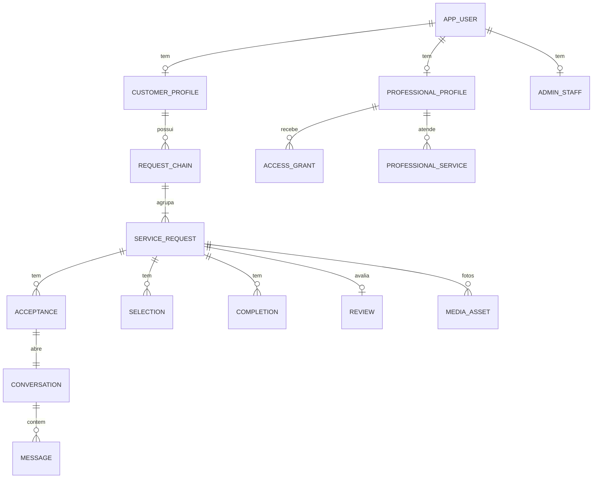

# FastPro — Modelo de dados lógico

- **Etapa:** architecture · **Data:** 2026-11-09 · **Papel:** Software Architect · **Status:** rascunho para validação humana (revisão 2)

## Histórico de mudanças
### Revisão 6 — 2026-11-10 (Rodada 14 nº 31 e 32; Revisão 5 do PO)
- **Fotos do pedido (decisão 31):** reduzidas **no envio** para ≈ **0,5 MB** e **no máximo 1.280 px**, **5 por pedido** (≈ 2,5 MB/pedido; ≈ 280 pedidos em ≈ 700 MB de Storage). **Só a versão reduzida é guardada**: o original e qualquer *master* maior nunca são persistidos. Supera o alvo "1–2 MB" da revisão 5.
- **Chat somente texto (decisões 32 e 33):** nenhum anexo, nem imagem nem PDF. **Removidos:** bucket `chat-attachments`, tabela `message_attachment`, validação por conteúdo e antimalware de anexos do chat, URLs assinadas e limites (5 × 10 MB) de anexo, miniatura e marca d'água do chat, e os riscos/testes de PDF do chat. A API **rejeita qualquer anexo** no chat. EXIF só se aplica às fotos do pedido.
- **Fotos extras** só via WhatsApp com opt-in (inalterado). **AMB-32 (PDF no chat) fica superada** pela decisão 33. **SD-12** (antivírus) é reduzida: sem anexos no chat, resta apenas o risco menor dos documentos de verificação (acesso só da Verificação).
- **Storage passa a ter apenas fotos do pedido e documentos de verificação de identidade**; estimativas refeitas (09 §9). O **egress de fotos (5 GB/mês)** segue como limite mais apertado.

### Revisão 5 — 2026-11-10 (Rodada 13 nº 28–30; doc 13)
- **Geocodificação permanente (decisão 29):** `request_draft`, `service_request` e `professional_area` só guardam coordenadas obtidas por `permanent=true` (`geocode_mode`, `geocoded_at`, `geocode_calls` com teto 3); nunca resultado temporário. `external_quota(mapbox_permanent)`.
- **Fotos (decisão 30):** trigger limita a 5 `media_asset` de pedido/rascunho. **§9 refeita** com limites verificados do Supabase Free (500 MB banco, 1 GB Storage, 5 GB egress) e 5 fotos/pedido; compressão 1–2 MB é PROPOSTA.

### Revisão 4 — 2026-11-09 (Rodada 12 nº 27)
- Todos os e-mails habilitados no código: `email_outbox.state` ganha `adiado_cota`; `external_quota(service='email')` com períodos dia UTC e mês e reserva para `auth` (§3.11). Continua sem tabela de flags e sem rotina de reenvio de antigos.

### Revisão 3 — 2026-11-09 (Rodadas 8 e 9)
- **Removida `notification_flag`** (sem interruptor, tela ou auditoria de flag, Rodada 9 nº 23): os avisos de aceite e de mensagem não lida são código desativado (sem tabela). `email_outbox.state` perde `suprimido_por_flag`. Mensagem de sistema do aceite com texto fixo "Estou disponível para trabalhar" (Rodada 8 nº 14). Reaceite proibido (Rodada 8 nº 19).

### Revisão 2 — 2026-11-09 (H4, H5, respostas 1–7, Rodada 7)
- **Removidos** `offer` e `offer_revision` (H4) e o campo de valor/prazo; **`participation` renomeada para `acceptance`** (§3.5), com regra única `(request_id, professional_id)`, status `ativo|retirado|removido_por_seguranca` e vaga sempre consumida.
- `service_request`: `acceptance_deadline_at` (era `offers_deadline_at`) e `acceptances_count` (era `offers_received`), contador da 2ª onda.
- `message` ganha `kind` (`humana|sistema`), `system_event`, `params` e `dedupe_key` única (mensagem de sistema idempotente) (§3.7).
- ~~Nova `notification_flag`~~ **revogada na revisão 3**; categoria `oferta` → `aceite` (§3.11).
- **Sem boleto (H5):** `payment.method ∈ {cartao, pix}`; carência de 72 h derivada também para Pix (§3.10).
- Resend como provedor de e-mail: `email_outbox.provider` (§3.11). Sem entidade de contrato/valor do serviço (preço é direto entre as partes).
- **Natureza:** modelo **lógico** (não é DDL final). Nomes e tipos podem mudar na implementação; **as constraints e invariantes não**. Planejamento apenas: nenhuma base foi criada.
- **Etiquetas:** `[APROVADO]` `[DELEGADO]` `[PROPOSTA]` `[NÃO VERIFICADO]` `[PENDENTE JURÍDICO]`
- **Relacionados:** `08-ARQUITETURA.md` (comportamento), `10-ADRS.md`, `11-ARQ-RISCOS-E-TESTES.md` (invariantes I-xx).
- **Regra sobre prazos:** nenhum prazo legal de retenção é definido aqui. As classes de retenção (§8) são mecanismos parametrizáveis; os valores ficam `[PENDENTE JURÍDICO]` (L1/L2) e a eliminação automática só é ligada depois que o jurídico definir.

## 1. Convenções
- Chaves primárias `uuid` (v7 se disponível, ordenável por tempo; senão v4). IDs são opacos e sem significado de negócio.
- Instantes `timestamptz` em UTC; comparações de prazo usam `now()` do banco. Fuso de apresentação e de cálculo de meses civis: `America/Sao_Paulo`.
- Valores monetários: **inteiro em centavos** (`amount_cents`) + `currency='BRL'`. R$ 200,00 = 20000.
- E-mail normalizado: minúsculas, Unicode NFC, IDN em ASCII; **não** remover pontos nem sufixo `+`.
- Colunas padrão: `created_at`, `updated_at`; exclusão lógica só onde indicado. Tabelas de domínio em esquemas **não expostos** à Data API: `app` (domínio), `billing`, `audit`, `ops` (operacional), `private` (funções).
- Toda tabela de domínio tem RLS **habilitada e forçada**; sem política = sem acesso (default-deny).
- Dados sensíveis marcados na matriz §7 (classes C3/C4).

## 2. Visão geral (agregados)

## 3. Entidades por módulo

### 3.1 identity
**app_user**: `id`, `auth_user_id` (único, Supabase Auth), `email` (normalizado, único), `email_verified_at`, `status` (`ativo|bloqueado`), `blocked_reason`. Check/trigger: se existe `admin_staff`, não pode existir `customer_profile`/`professional_profile`.
**customer_profile**: `user_id` (PK/FK), `created_at`. (Nome e telefone vivem no pedido, §3.4.)
**auth_challenge**: `id`, `email_hash` (HMAC), `purpose` (`login|publish`), `token_hash`, `code_hmac`, `draft_id?`, `browser_nonce_hash`, `expires_at` (+15 min), `consumed_at`, `attempts` (≤5), `ip_hmac`, `created_at`. Índice `(email_hash, created_at)`; expurgo técnico por TTL curto.
**app_session**: `sid`, `user_id`, `created_at`, `expires_at` (≤ +7 dias), `revoked_at`, `recent_auth_at`, `ua_class`, `ip_hmac`. Índice `(user_id) WHERE revoked_at IS NULL`.

### 3.2 catalog
**service_group** (`id`, `name`, `position`, `active`) · **service** (`id`, `group_id`, `name`, `modality` {`presencial|online|ambos`}, `regulated` bool [DELEGADO/L4], `active`) · **service_synonym** (`service_id`, `term`, índice trigram/`tsvector` para autocomplete). Conteúdo inicial: `06-CATALOGO-PROPOSTO.md` [PROPOSTA].

### 3.3 verification / profissional
**professional_profile**: `user_id`, `public_name`, `slug` (único), `document_type` {`CPF|CNPJ`}, `document_enc` (criptografado, §7), `document_hmac` (**único** entre perfis não recusados; base do "um trial/uma vaga por identidade"), `identity_id` (id lógico da identidade, = `document_hmac` resolvido), `verification_status`, `verified_at`, `suspended_at`, `suspension_reason`.
**professional_service**: `professional_id`, `service_id`, `modality` {`presencial|online`}; PK composta.
**professional_area**: `professional_id`, `base_point geography(Point)` (privado; **somente de resultado `permanent=true`**, `geocoded_at`), `base_label`, `radius_m` (CHECK 5.000–100.000, [DELEGADO]), `updated_at`; mudança limitada em taxa; histórico em auditoria.
**verification_case**: `id`, `professional_id`, `status` (`pendente|em_revisao|retida_duplicidade|aprovada|recusada|suspensa`), `assigned_to`, `reason_code`, `explanation_to_professional`, `appeal_status`, `decided_by`, `decided_at`, `sla_target_at` (meta, não promessa). **verification_case_event** (histórico imutável).
**identity_document**: `id`, `professional_id`, `kind` {`identidade|certificacao`}, `service_id?` (certificação), `media_asset_id`, `status`. Conteúdo em bucket `identity-docs`.

### 3.4 requests
**request_draft**: `id`, `browser_nonce_hash`, `email?`, `first_name?`, `service_id?`, `address_text?`, `exact_point?` (**só após geocodificação permanente**), `geocoded_at?`, `geocode_calls` smallint (teto 3), `urgency?`, `description?`, `phone_enc?`, `phone_share_opt_in` (default false), `status` {`aberto|aguardando_email|descartado|publicado`}, `expires_at` (TTL, `[PROPOSTA]` configurável), `ip_hmac`. Fotos: `media_asset(draft_id)`. Expurgo por TTL.
**request_chain**: `id`, `customer_user_id`, `root_request_id` (**único**), `created_at`. Criada preguiçosamente na primeira republicação.
**service_request**: 
`id`, `customer_user_id`, `chain_id?`, `is_republication` bool, `republished_from_id?`, `service_id`, `urgency` {`imediato|proximas_semanas|proximo_mes|nao_definido`}, `description`,
`status` {`publicado|selecionado|concluido|cancelado`}, `version` int (concorrência otimista),
`published_at`, `acceptance_deadline_at` (= `published_at + 7 dias corridos`, **imutável**: trigger bloqueia UPDATE), `wave2_opened_at?`, `acceptances_count` int (mantido sob lock + verificado por trigger/rotina de consistência),
`exact_point` (C3; **somente de resultado `permanent=true`**), `geocode_mode` {`permanent`} (CHECK: `exact_point IS NOT NULL ⇒ geocode_mode='permanent'`), `geocoded_at`, `match_point` (célula generalizada), `public_label` (bairro/cidade/UF), `address_text_enc` (C3),
`first_name` (snapshot visível a participantes), `phone_enc?` (C3), `completed_at?`, `cancelled_at?`, `cancelled_by`.
Checks: `status<>'publicado' OR selecionado inexistente` (via trigger); `wave2_opened_at IS NULL OR wave2_opened_at >= published_at`.
Índices: `GIST(match_point)`; `(customer_user_id, status)`; `(service_id, status, acceptance_deadline_at)`; `(chain_id)`; **único parcial** `(chain_id) WHERE is_republication AND status IN ('publicado','selecionado')` (I-09).
**duplicate_ack**: `request_id`, `similar_request_id`, `confirmed_at` (AMB-01).

### 3.5 distribution
**acceptance** (aceite de trabalho; substitui `participation`): `id`, `request_id`, `professional_id`, `identity_id`, `slot_no` smallint CHECK 1..8, `wave` generated `((slot_no-1)/4)+1`, `status` {`ativo|retirado|removido_por_seguranca`}, `accepted_at`, `withdrawn_at?` (CHECK: `status='retirado' ⇔ withdrawn_at IS NOT NULL`), `removed_reason?`, `created_at`. **Sem** texto, valor, prazo ou anexo.
Únicos: `(request_id, professional_id)` (**regra única do aceite**, vale também após retirada: sem reaceite, Rodada 8 nº 19), `(request_id, identity_id)`, `(request_id, slot_no)`. Trigger `BEFORE INSERT`: `slot_no>4` exige `wave2_opened_at`; `slot_no = acceptances_count+1`; `slot_no <= 4` se onda 2 fechada; profissional ≠ cliente (`app_user`); pedido `publicado` e `now() < acceptance_deadline_at`. Trigger `BEFORE UPDATE`: `slot_no`, `request_id`, `professional_id` imutáveis; `status` só `ativo→retirado|removido_por_seguranca`; `DELETE` negado (a vaga nunca é liberada). `acceptances_count` = número de linhas do pedido (todas as status), verificado por rotina de consistência (I-21). A conversa nasce no mesmo `INSERT` lógico (§3.7).
*(Entidades `offer` e `offer_revision` extintas por H4; SD-08 extinta.)*
**wave_event** (opcional, auditável): `request_id`, `kind` {`wave2_opened`}, `at`, `actor`.

### 3.6 selection / conclusão
**selection**: `id`, `request_id`, `acceptance_id`, `professional_id`, `selected_at`, `ended_at?`, `ended_reason` {`trocada|...`}, `professional_withdrawn_at?`, `withdrawn_note?`. **Único parcial** `(request_id) WHERE ended_at IS NULL` (I-04). FK composta garante que `participation.request_id = selection.request_id`.
**completion**: `id`, `request_id`, `selection_id`, `completed_at`, `completed_by` (cliente), `reverted_at?`, `reverted_by?`, `revert_kind` {`direta|administrativa`}. **Único parcial** `(request_id) WHERE reverted_at IS NULL`.

### 3.7 chat / mídia
**conversation**: `id`, `request_id`, `customer_user_id`, `professional_id`, `acceptance_id` (**único**, FK; 1 aceite ⇒ 1 conversa), `state` {`ativa|somente_leitura`}, `security_restricted_at?`, `restricted_reason?`. **Único** `(request_id, professional_id)`.
**conversation_member_state** (preferência individual): `conversation_id`, `user_id`, `archived_at?`, `last_read_message_id?`, `muted?`.
**message**: `id`, `conversation_id`, `kind` {`humana|sistema`}, `sender_user_id` (**nulo** se `kind='sistema'`), `client_message_id` (**único** com `(conversation_id, sender_user_id)`, só `humana`), `system_event` {`aceite|aceite_retirado`} (obrigatório se `sistema`), `params` (jsonb: apenas IDs; sem texto livre/PII), `template_version`, `dedupe_key` (**único parcial** `(conversation_id, dedupe_key) WHERE kind='sistema'`; ex.: `acceptance:{id}:accepted`), `body_text?` (só `humana`), `created_at`, `state` {`enviada|restrita`}. CHECKs: `kind='sistema' ⇒ sender_user_id IS NULL AND system_event IS NOT NULL AND body_text IS NULL`; `kind='humana' ⇒ sender_user_id IS NOT NULL`. Triggers: `UPDATE`/`DELETE` negados ao papel de aplicação (RF-103, vale para a de sistema); `INSERT humana` exige conversa `ativa`, sem `security_restricted_at` e remetente membro; `INSERT sistema` só pela função interna do domínio (papel `app_api` sem `INSERT` direto na tabela), com conversa `ativa` no instante (a de `aceite_retirado` é inserida antes de a conversa virar `somente_leitura`). O texto exibido é renderizado do modelo versionado + `params` (RF-075); para `aceite` o texto é fixo: "Estou disponível para trabalhar".
**media_asset**: `id`, `owner_kind` {`draft|request|identity|certification`}, `owner_id`, `uploader_user_id`, `bucket`, `object_key` (aleatório), `declared_mime`, `detected_mime`, `bytes` (≤10 MB), `status` {`pending|scanning|ready|rejected`}, `reject_reason`, `exif_stripped` bool, `width`, `height`, `created_at`, `purge_after?`. CHECK exatamente um dono. CHECKs: `owner_kind in ('draft','request') ⇒ GREATEST(width,height) <= 1280` e `bytes` ≤ teto técnico (alvo ≈ 0,5 MB, teto `[PROPOSTA]` 0,75 MB em `app_config`); só a **versão reduzida** é persistida (sem coluna nem objeto de original/*master*); `exif_stripped` aplica-se só às fotos do pedido. Trigger: no máximo **5** `media_asset` não rejeitados com `owner_kind in ('draft','request')` por rascunho/pedido (decisão 30); o 6º é recusado (`photo_limit`). Fotos adicionais só por WhatsApp, fora da plataforma.
**media_access_log** (D10): `at`, `professional_id`, `request_id`, `asset_id`, `outcome` {`ok|negado|limitado`}, `ip_hmac?`. **Compacta**; *rollup* diário e expurgo operacional (§9, §10).
**chat_report** / **user_block**: denúncia de mensagem e bloqueio por usuário.

### 3.8 privacidade
**contact_consent**: `id`, `request_id`, `kind` {`telefone`}, `scope` {`todos_participantes|profissional`}, `professional_id?` (obrigatório se `scope=profissional`), `granted_at`, `granted_via` {`formulario_pedido|chat`}, `text_version`, `revoked_at?`. Consulta "ativa" = `revoked_at IS NULL`. Revogação vale para o futuro (AMB-17 C). **Nunca copiado** para pedido republicado (RF-017).
**address_share**: `request_id`, `professional_id`, `shared_at`, `revoked_at?` (RF-139).
**contact_reveal_log**: `request_id`, `professional_id`, `kind`, `at` (cada revelação).
**dsr_case** (direitos do titular): `id`, `subject_user_id`, `kind`, `status`, `legal_basis_note`, `opened_at`, `closed_at`, `outcome`. Fluxo separado de moderação [PENDENTE JURÍDICO].
**retention_policy**: `data_class`, `trigger_event`, `period` (**nulo = não definido**), `action` {`excluir|anonimizar|reter`}, `legal_basis_ref`, `approved_by`, `effective_from`, `enabled` (padrão false).
**legal_hold**: `subject_ref`, `reason`, `placed_by`, `released_at?` (suspende expurgo).

### 3.9 reviews
**review**: `id`, `request_id` (**único**), `completion_id`, `professional_id`, `rating` smallint CHECK 1..5, `comment?`, `state` {`em_validacao|publicada|rejeitada_conteudo|retida_revisao|oculta_por_decisao|em_revisao_validade}, `published_at?`, `edit_until` (= `published_at + 7 dias`), `filter_result` (código, sem o texto), `author_label` fixo "Cliente do FastPro" (nunca e-mail/nome).
**review_reply** (uma por avaliação, profissional) · **review_dispute** (contestação fundamentada do profissional; vincula a `moderation_case`).
**professional_rating_agg**: `professional_id`, `count`, `sum`, atualizado na transação de publicação/ocultação.
Gatilhos: avaliação exige `completion` não revertida e `professional_id = selection.professional_id` (I-08); reversão de conclusão com avaliação ⇒ `em_revisao_validade` + caso (RF-133).

### 3.10 billing
**plan** (`code` {`mensal|trimestral|semestral|anual`}, `months` 1/3/6/12, `active`) · **plan_price** (`plan_id`, `amount_cents`, `valid_from`, `valid_to?`; valores aprovados: 2990, 8070, 14940, 23880; sem promoção no MVP).
**access_grant**: `id`, `professional_id`, `type` {`trial|paid|adjustment`}, `starts_at`, `ends_at`, `grace_until?`, `source_payment_id?`, `status` {`ativa|revogada`}; a **carência de 72 h não é armazenada**: é derivada (`period_end + 72 h`, §8 de `08`) e vale para `type='paid'` sem `cancel_at_period_end`. **Único parcial** `(identity_id) WHERE type='trial'` (um trial por identidade, AMB-09 A) — via coluna `identity_id` redundante.
**subscription**: `id`, `professional_id`, `plan_id`, `provider` {`mercadopago`}, `provider_subscription_id?`, `mode` {`cartao_recorrente|manual`}, `auto_renew_opt_in_at?`, `auto_renew_text_version`, `status_provider`, `cancel_at_period_end`, `canceled_at?`.
**payment**: `id`, `professional_id`, `subscription_id?`, `provider_payment_id` (**único** por provedor), `method` {`cartao|pix`} (CHECK; **sem boleto**, H5), `amount_cents`, `plan_price_id`, `status` {`aprovado|pendente|recusado|estornado|chargeback`}, `paid_at?`, `period_start?`, `period_end?`.
**provider_event** (inbox): `id`, `provider`, `event_key` (**único** com provider), `topic`, `resource_id`, `received_at`, `signature_ok`, `processed_at?`, `outcome`, `payload_ref` (JSON mínimo, **expurgo curto**).
**refund_request** (`payment_id`, `amount_cents`, `status`, `approval_request_id`) · **access_adjustment** (`professional_id`, `reason`, `approval_request_id`).
**Função** `commercial_access(professional, at)` ⇒ estado derivado (`sem_acesso|trial_ativo|trial_expirado|ativa|em_carencia|expirada|cancelada_com_acesso_ate_fim_do_periodo`) e `access_until`.

### 3.11 notifications / plataforma
**notification_item**: `id`, `recipient_user_id`, `category` {`aceite|mensagem|cancelamento|selecao|desistencia|prazo|verificacao|acesso|outro`}, `scope_key` (pedido ou conversa), `source_event_id`, `state` {`pendente|enviado|descartado`}, `created_at`.
*(Sem tabela de flags nem de interruptores: todos os e-mails estão habilitados no código, `08` §12.2.)*
**notification_cooldown**: `(recipient_user_id, category, scope_key)` PK, `cooldown_until`, `flush_job_id?`.
**email_outbox**: `id`, `recipient_email_ref` (referência a `app_user`, não texto solto), `template`, `class` {`auth|critico|digest|lembrete`}, `dedupe_key` (**único**), `email_type` (enum no código), `provider` {`resend|...`} (adapter, `EmailProviderPort`), `state` {`pendente|enviando|enviado|falha|suprimido|adiado_cota`}, `attempts`, `next_attempt_at`, `provider_message_id?`, `bounce_state?`. **email_suppression**: bounce/complaint.
**outbox_event**: `id` (= event_id), `type`, `version`, `aggregate_type`, `aggregate_id`, `aggregate_seq`, `occurred_at`, `actor_ref`, `correlation_id`, `payload` (sem PII), `dispatched_at?`.
**job**: `id`, `kind`, `dedupe_key` (**único**), `run_at`, `state`, `lease_until`, `attempts`, `payload_ref`. Índice `(state, run_at)`.
**idempotency_key**: `principal_id`, `operation`, `key`, `request_hash`, `state`, `response_status`, `response_body_ref`, `expires_at`. Único `(principal_id, operation, key)`.
**app_config**: parâmetros administráveis (janela de digest por categoria, limites de taxa, TTLs, raios de duplicidade, tamanho de célula, janela de step-up) com `value`, `updated_by`, histórico.
**external_quota**: `service` {`mapbox_geocoding_temp|mapbox_permanent|email|storage|db|…`}, `period` {`dia_utc|mes|…`}, `period_start`, `used` (e-mail: **por destinatário**; Mapbox permanente: chamadas e gasto estimado), `soft_limit`, `hard_limit`, `reserved_auth` (parcela só para `auth`), `breaker_state`, `alerted_at`. Valores iniciais `[PROPOSTA]`: e-mail dia 100 (alerta ≥ 90, reserva 10) e mês 3.000 (alerta ≥ 2.700, reserva 300), doc 13; Mapbox permanente: `hard_limit` abaixo do limite de gasto da conta; temporário: alerta em 70/85/95% de 100.000/mês.
**rate_counter**: balde de fichas para limites de baixa frequência (login, publicar): `(key_hmac, window)`, `count`. Alta frequência fica em memória por instância (ADR-014).
**abuse_signal**: `subject_ref`, `kind`, `score`, `detail_code`, `at`, `handled_by?`.
**ops_metric**: série agregada para o painel interno (sem PII).

### 3.12 admin
**admin_staff** (H-102): `user_id` (→ app_user), `status` {`pendente_mfa`,`ativo`,`desativado`}, `origin` {`convite`,`bootstrap`}, `invited_by`, `mfa_enrolled_at`, `created_at`, `status_changed_at`. Ativo exige TOTP confirmado. **admin_role**, **admin_permission**, **admin_role_permission** (semente do mapa de 54 §1), **admin_user_role** (`user_id`, `role_code`, `granted_by`, `grant_origin`, `granted_at`, `approval_request_id`, `revoked_by`, `revoked_at`; um ativo por papel).
**admin_invite** (H-102): `kind` {`ativacao`,`reenrolamento`}, `email_hmac`, `email_enc` (só enquanto vivo), `token_hash`, `role_codes`, `invited_by`, `approval_request_id`, `state` {`emitido`,`aguardando_totp`,`usado`,`invalidado`}, `attempts` (máx. 5), `user_id`, `expires_at` (72 h). Um vivo por e-mail. **admin_session** (H-102): `user_id`, `secret_hash`, `aal2_at`, `expires_at` (8 h), `revoked_at`.
**approval_request**: `id`, `action_type` {`papel_superadmin`,`mfa_reenroll`} na H-102 (`estorno_gt_200`, `suspensao_permanente` e demais entram em H-105, pela história própria), `subject_user_id` (opcional: convite de Superadmin), `detail_code`, `requested_by`, `required_approvals` (1), `status` {`pendente`,`aprovada`,`rejeitada`,`expirada`,`consumida`}, `created_at`, `expires_at` (24 h), `consumed_at`. **approval_vote**: `(approval_request_id, approver_id)` único; trigger `approver_id <> requested_by`, `approver_id <> subject_user_id`, aprovador Superadmin ativo.
Desvios de H-102 em relação a este texto (registrados em 54 §1 e §8): `papel_critico` não foi usado (o papel crítico é `papel_superadmin`); `action_type` do §3.12 original fica para H-105.
**access_case**: `id`, `opened_by`, `authorized_by` (≠ `opened_by`), `justification`, `scope_kind`, `scope_id`, `expires_at`, `closed_at`. **sensitive_access_log**: cada leitura (quem, o quê, caso, instante).
**moderation_case**: denúncia/contestação, `state`, `decision`, `rationale`, `decided_by`, `appeal_state`.
**audit_event** (`audit`): `id`, `at`, `actor_ref`, `actor_role`, `action`, `object_type`, `object_id`, `before_state`, `after_state` (somente estado/IDs), `reason_code`, `correlation_id`, `prev_hash`, `row_hash`. **Append-only** (privilégios `INSERT` apenas; trigger bloqueia UPDATE/DELETE); particionada por mês `[PROPOSTA]`.

## 4. Estados e transições permitidas (para triggers e testes)
| Entidade | De | Para | Quem | Observação |
|---|---|---|---|---|
| service_request | (novo) | publicado | cliente (via publicação) | `acceptance_deadline_at = published_at + 7d` |
| | publicado | selecionado | cliente | participante com aceite `ativo` e elegível |
| | selecionado | selecionado | cliente | troca; seleção anterior encerrada |
| | selecionado | concluido | cliente | seleção ativa |
| | concluido | selecionado | cliente (≤24 h, sem avaliação publicada) / Suporte | nunca reabre admissão |
| | publicado, selecionado | cancelado | cliente | confirmação expressa |
| | concluido, cancelado | — | — | `cancelado` é terminal; republicar cria outro pedido |
| acceptance | ativo | retirado | profissional (antes de ser a seleção ativa) | vaga permanece consumida; conversa → somente leitura; mensagem de sistema `aceite_retirado` |
| acceptance | ativo | removido_por_seguranca | sistema/admin | vaga permanece consumida |
| acceptance | retirado / removido | ativo | — | **proibido** (sem reaceite, Rodada 8 nº 19) |
| conversation | ativa ↔ somente_leitura | recompute | sistema | §6.1 de `08` |
| review | em_validacao | publicada / rejeitada_conteudo / retida_revisao | sistema | AMB-12 |
| review | publicada | oculta_por_decisao / em_revisao_validade | Moderador / reversão de conclusão | sem exclusão silenciosa |
| verification_case | pendente | em_revisao → aprovada / recusada / retida_duplicidade | Verificação | recurso → em_revisao |
| aprovada | | suspensa | Admin (dupla aprovação p/ permanente) | |
| access_grant | — | ativa/revogada | sistema / Financeiro | |
Qualquer transição fora desta tabela é rejeitada pela aplicação e, onde possível, por trigger.

## 5. Índices e desempenho [PROPOSTA]
| Consulta | Índice |
|---|---|
| Descoberta (elegíveis por raio) | GiST `service_request(match_point)`; btree `(service_id, status, acceptance_deadline_at)`; GiST `professional_area(base_point)` |
| Painel do cliente | `(customer_user_id, status, published_at DESC)` |
| Caixa do chat | `message(conversation_id, created_at, id)`; `conversation(customer_user_id)`, `(professional_id)` |
| Vagas | únicos de `acceptance`; contagem sob lock (índice `(request_id)`) |
| Jobs/outbox | `(state, run_at)` parcial; `outbox_event(dispatched_at) WHERE dispatched_at IS NULL` |
| Auditoria | `(object_type, object_id, at)`, `(actor_ref, at)` |
| Avaliações | `review(professional_id, published_at DESC) WHERE state='publicada'` |
| Autocomplete | trigram/`tsvector` em `service` e `service_synonym` |
| Idempotência | único `(principal_id, operation, key)` |
Avaliar `EXPLAIN` com dados sintéticos de volume realista antes do lançamento; limite de banco gratuito (§9) influencia a escolha de índices (cada índice custa espaço).

## 6. Catálogo de políticas RLS (esboço) [PROPOSTA]
| Tabela | Cliente | Profissional | Admin |
|---|---|---|---|
| service_request | dono | participante (via **view** sem e-mail/telefone/endereço); elegível via função de descoberta | por permissão e caso |
| acceptance | dono do pedido (leitura) | próprio registro; criação só pela função `accept_work` | idem |
| conversation, message | membro | membro | **somente com `access_case`** |
| media_asset | dono | via função autorizada (sem leitura direta) | idem |
| contact_consent | dono | nenhum (resultado só pela API) | caso |
| professional_profile | — | próprio (campos próprios) | Verificação (fila) |
| identity_document | — | próprio | Verificação com tarefa atribuída |
| billing.* | — | próprio (leitura) | Financeiro |
| audit.* | — | — | Auditor (SELECT), ninguém grava fora da transação de domínio |
Todos os papéis `anon`/`authenticated`: sem grant nas tabelas; exceção `realtime.messages` para canais privados (autorização por participação).

## 7. Matriz de dados sensíveis
Classes: **C0** público · **C1** interno · **C2** pessoal comum · **C3** pessoal de alto risco/sensível (documento, endereço exato, conteúdo privado, imagem de residência) · **C4** segredo/credencial.
Controles: **Enc** = criptografia de aplicação em coluna/objeto com chave versionada (chave via gestor de segredos; origem do KMS em SD-11); em repouso do provedor `[NÃO VERIFICADO]` além disso.

| Dado | Tabela/local | Classe | Quem lê | Proteções | Log de acesso | Retenção (classe §8) |
|---|---|---|---|---|---|---|
| E-mail do cliente | app_user.email | C2 | dono; sistema (envio); admin com caso | nunca em views de profissional; mascarar em logs | consulta admin | RC-02 |
| Primeiro nome do cliente | service_request.first_name | C2 | dono; participantes | só após aceite `ativo` | — | RC-03 |
| Telefone/WhatsApp | service_request.phone_enc, draft | C3 | dono; participante com consentimento | Enc; endpoint de revelação separado | `contact_reveal_log` | RC-03 / RC-10 |
| Endereço completo | service_request.address_text_enc, exact_point | C3 | dono; participante com `address_share`; admin com caso | Enc do texto; `exact_point` nunca em views de profissional | sim | RC-03 |
| Ponto generalizado / rótulo | match_point, public_label | C2 | elegíveis e participantes | célula 500 m `[PROPOSTA]` | — | RC-03 |
| Fotos do pedido | bucket request-photos | C3 | dono; participantes; elegíveis (marca d'água) | EXIF removido; URL ~60 s; sem original a profissionais | `media_access_log` | RC-03 |
| Mensagens | message | C3 | membros; admin com caso | sem edição/exclusão; trigger | `sensitive_access_log` | RC-04 | Conversas (somente texto) | idem; moderação | excluir/anonimizar; *legal hold* | `[PENDENTE JURÍDICO]` L1 |
| CPF/CNPJ | professional_profile.document_enc / document_hmac | C3 | profissional; Verificação (tarefa) | Enc + HMAC para unicidade; nunca em log | sim | RC-01 |
| Documentos de identidade/certificação | bucket identity-docs | C3 | profissional; Verificação (tarefa); admin com caso | Enc de objeto `[PROPOSTA]`; URL ~60 s | `sensitive_access_log` | RC-01 |
| Perfil público | professional_profile (campos públicos) | C0 | todos | só campos permitidos | — | RC-02 |
| Avaliações | review | C0/C2 | todos (publicadas) | autor fixo "Cliente do FastPro" | decisões auditadas | RC-05 |
| Pagamentos | billing.payment | C2 (financeiro) | profissional (próprios); Financeiro | sem dados de cartão (checkout do MP) | auditoria | RC-06 |
| Segredos (chaves MP, Mapbox, service_role, pepper) | gestor de segredos | C4 | processos | nunca em repo/log/prompt; rotação | — | — |
| Sessões, desafios, IP (HMAC) | app_session, auth_challenge | C2/C4 | sistema | hash/HMAC; TTL curto | — | RC-09 |
| Auditoria | audit_event | C1/C2 | Auditor | append-only; sem PII em claro | próprio | RC-07 |
| Logs operacionais | provedor de logs | C1 (sem PII) | engenharia | allowlist | — | RC-08 |
| Backups | destino de backup | herda C3 | operador autorizado | criptografia com chave separada | sim | RC-11 |

## 8. Classes de retenção (mecanismo, sem prazos)
| Classe | Dados | Gatilho típico (a definir) | Ação possível | Período |
|---|---|---|---|---|
| RC-01 | Documentos/identidade de profissional | decisão final, encerramento da conta | excluir/anonimizar | `[PENDENTE JURÍDICO]` L1 |
| RC-02 | Cadastro (e-mail, perfil) | encerramento/inatividade | anonimizar | `[PENDENTE JURÍDICO]` L1 |
| RC-03 | Pedido, fotos, endereço, telefone | conclusão/cancelamento/expiração | excluir mídia e dados exatos; manter registro mínimo | `[PENDENTE JURÍDICO]` L1 |
| RC-04 | Conversas e anexos | idem; moderação | excluir/anonimizar; *legal hold* | `[PENDENTE JURÍDICO]` L1 |
| RC-05 | Avaliações | AMB-14: aguardar jurídico | manter/anonimizar | `[PENDENTE JURÍDICO]` L1 (FA-020 condicionado) |
| RC-06 | Registros financeiros/fiscais | conforme obrigações | reter | `[PENDENTE JURÍDICO]` L1/L3 |
| RC-07 | Auditoria e logs de acesso a dados sensíveis | — | reter/anonimizar atores | `[PENDENTE JURÍDICO]` L1 |
| RC-08 | Logs operacionais, métricas | técnico | expurgo rotativo | prazo técnico `[PROPOSTA]` (curto, restrito ao armazenamento gratuito) |
| RC-09 | Desafios, sessões, rascunhos, idempotência, inbox | técnico (TTL) | expurgo | TTL técnico `[PROPOSTA]` (ex.: desafio 15 min, rascunho configurável) — **não** são prazos legais |
| RC-10 | Consentimentos de contato | — | reter prova do consentimento | `[PENDENTE JURÍDICO]` L1/L2 |
| RC-11 | Backups | rotação | sobrescrever | `[PENDENTE JURÍDICO]` L1 (exclusão do titular × cópias) |
Mecanismo: `retention_policy` (valor nulo = política não aprovada ⇒ job **desligado**), `legal_hold`, jobs de expurgo idempotentes e auditados, eliminação de objetos em Storage no mesmo ciclo. "Sem prazo comercial" de avaliação **não** autoriza retenção indefinida (doc 06 §7).
Pendências que afetam o modelo: exclusão de conta × auditoria/moderação/financeiro; exigência de exclusão de conta nas lojas na fase mobile `[NÃO VERIFICADO]` (ADR-019); localização dos dados (SD-11).

## 9. Orçamento de dados no plano gratuito [limites VERIFICADOS (doc 13); estimativas PROPOSTA/hipótese]
Supabase Free: **banco 500 MB**, **Storage 1 GB** (upload máx. 50 MB), **egress 5 GB/mês**, 50.000 MAU, logs de 1 dia, **sem backup**, pausa após 1 semana, 2 projetos ativos. Pro a partir de US$ 25/mês (limites do Pro não lidos).

**Premissas (decisões 30–33):** 5 fotos por pedido, cada uma reduzida a **≤ 1.280 px e ≈ 0,5 MB**, guardando **só a versão reduzida**; chat **somente texto, sem anexos**; Storage = **fotos do pedido + documentos de verificação de identidade**. Divisão usada: fotos ≈ 70% de 1 GB ≈ **700 MB**; documentos ≈ 30% ≈ 300 MB (≈ 100–300 profissionais a 1–3 MB).
| Item | Cálculo | Resultado |
|---|---|---|
| Foto do pedido | ≈ 0,5 MB × 5 | **≈ 2,5 MB por pedido** |
| Capacidade de fotos (5 por pedido) | 700 MB ÷ 2,5 MB | **≈ 280 pedidos** |
| Capacidade se a média for 3 fotos (hipótese) | 700 MB ÷ 1,5 MB | ≈ 470 pedidos |
| Teto técnico de 0,75 MB por foto (pior caso de recompressão) | 700 MB ÷ 3,75 MB | ≈ 190 pedidos |
Os números substituem os da revisão 5 (alvo 1–2 MB ⇒ 70–140 pedidos). **Sem anexos no chat, nada mais compete com as fotos e os documentos:** cada 100 MB livres de documentos ≈ +40 pedidos com 5 fotos (ex.: com 100 profissionais a 2 MB, sobram ≈ 500 MB e as fotos podem usar ≈ 800 MB ⇒ ≈ 320 pedidos). **Conclusão:** algumas centenas de pedidos com foto; serve à validação/lançamento restrito, não à escala. **Gatilho:** 70% do Storage ⇒ revisar cotas/expurgo; 85% ⇒ decisão de upgrade (Pro) ou expurgo permitido pelo jurídico (RC-03; 12-TODO #10).

| Item | Estimativa (hipótese a calibrar com dados sintéticos) | Efeito |
|---|---|---|
| **Egress de fotos** | a derivada servida (versão reduzida + marca d'água) pesa ≈ 0,25–0,5 MB; 5 fotos × ~20 profissionais ⇒ **≈ 25–50 MB por pedido**; prévias ≈ 320 px (≈ 30 KB) na listagem reduzem o total | 5 GB/mês comportam **≈ 100–200 pedidos por mês** só em fotos: **é o limite mais apertado** (antes do Storage) |
| Documentos de identidade | ≈ 1–3 MB por profissional (reencodar) | ≈ 100–300 profissionais em ≈ 300 MB; único consumidor de Storage além das fotos |
| Banco por pedido | ≈ 50–150 KB incluindo 8 conversas, mensagens e índices | ≈ 3.000–10.000 pedidos em 500 MB (antes de auditoria) |
| `media_access_log` | ≈ 100 B/linha ⇒ 1 M linhas ≈ 100 MB | *rollup* e expurgo obrigatórios |
| Auditoria | ≈ 0,5–1 KB/evento | cresce sempre; arquivar comprimido |
| Inbox de webhooks / idempotência / outbox entregue | expurgo curto | evita inchaço |
Gatilhos: 70% ⇒ alerta; 85% ⇒ endurece cotas e expurgos; 95% ⇒ bloqueia novos uploads de baixo valor; egress ≥ 70% do mês ⇒ reduzir derivadas/prévias ou avaliar upgrade. Estas contas são **hipóteses de dimensionamento**, não medições.

## 10. Expurgos operacionais obrigatórios
Rascunhos e uploads em `quarantine` por TTL; desafios e sessões vencidos; `provider_event` processado; `outbox_event` despachado; `idempotency_key` vencido; `media_access_log` com *rollup* diário (preserva contagem por profissional/dia para detecção) e remoção do detalhe depois de janela técnica; anexos órfãos. Todos jobs idempotentes, com *lease* e métricas (§14 de `08`).
